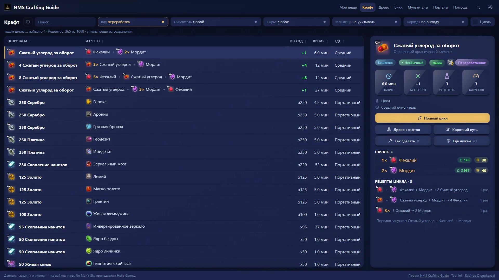
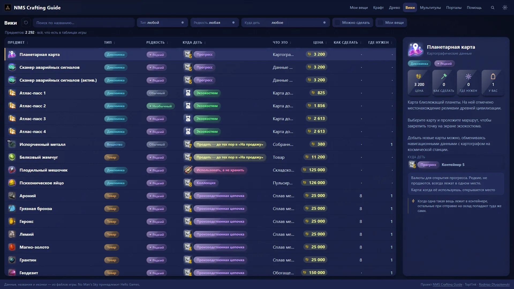

  
  
  

  
  
  
  

**English** · [Русский](docs/readme/README.ru.md) · [Português (Brasil)](docs/readme/README.pt-BR.md) · [Português](docs/readme/README.pt.md) · [Español](docs/readme/README.es.md) · [Français](docs/readme/README.fr.md) · [Deutsch](docs/readme/README.de.md) · [Italiano](docs/readme/README.it.md) · [Nederlands](docs/readme/README.nl.md) · [Polski](docs/readme/README.pl.md) · [日本語](docs/readme/README.ja.md) · [한국어](docs/readme/README.ko.md) · [简体中文](docs/readme/README.zh-CN.md) · [繁體中文](docs/readme/README.zh-TW.md)

## What is it?

You are standing at a refiner and wondering: *what does this turn into, and what is the quickest way to get that item
from what I'm carrying?* NMS Crafting Guide answers in a couple of clicks.

It is a small program for your computer. It reads recipes, prices and names **straight from your own copy of the
game**, so the numbers are the ones your game really uses, not what a wiki remembered from an older patch.

- 🧪 **Every recipe in one table.** Refining, cooking and nanite routes. Sort by yield, time or profit.
- 🌳 **Every way to make an item**, drawn as a tree, from the simplest to the hardest.
- 🍲 **Eat or sell?** Find the dish with the buff you need and see what it sells for.
- 📦 **Where does it go?** Every item with the storage it belongs in.
- 🔁 **Money loops.** Recipes that feed each other and leave you with more than you started with.
- 🔭 **Portal addresses.** Type a code in either form and see the glyphs to dial.
- ⚔️ **Multi-tools** compared side by side, and how to get the good ones.
- 🌍 **17 languages**, the same ones the game has. Item names change with the language too.
- 🔒 **Private.** Nothing leaves your computer. No account, no internet needed after the first run.

## Install

| | |
| --- | --- |
| **Windows** | Download `nms-crafting-guide-Setup-….exe` from the [latest release](https://github.com/Topl1nk/nms-crafting-guide/releases/latest) and run it. No administrator rights needed. The installer speaks 14 languages. |
| **Linux** | Download `nms-crafting-guide-….AppImage`, make it executable and double-click it. |

Windows may show a *"Windows protected your PC"* warning, because the program is new and not signed. Press
*More info → Run anyway*.

**First launch.** NMS Crafting Guide finds your No Man's Sky installation (Steam or GOG) and takes the item pictures from it. This
takes a few minutes and happens once. If you switch to a language that has not been prepared yet, the first switch takes
about a minute, and item names then change on the spot. The pictures and texts stay on your computer; they belong to
Hello Games and are never uploaded or shared.

## A look around

<table>
  <tr>
    <td width="50%"> <b>Craft tree.</b> Every way to make an item, with what to gather.</td>
    <td width="50%"> <b>Cooking.</b> The strongest dishes for the buff you want.</td>
  </tr>
  <tr>
    <td width="50%"> <b>Nanites.</b> Every route, ranked by nanites per hour.</td>
    <td width="50%"> <b>Wiki.</b> Every item of the game with its card.</td>
  </tr>
  <tr>
    <td width="50%"> <b>My items.</b> What you carry and where each thing belongs.</td>
    <td width="50%"> <b>Portals.</b> Codes and addresses, with the glyphs drawn.</td>
  </tr>
  <tr>
    <td width="50%"> <b>Multi-tools.</b> Eight types compared, and how to get the best ones.</td>
    <td width="50%"> <b>Pick any item</b> that can be made and see how.</td>
  </tr>
</table>

### Your language

One choice in the settings menu (the cog) changes the page and the game's own names together.

<table>
  <tr>
    <td width="50%"></td>
    <td width="50%"></td>
  </tr>
</table>

## Good to know

- **Light or dark**, any accent colour, bigger text, glowing icons. All in the settings menu.
- **Short path.** Pick an item and NMS Crafting Guide finds the way to make it from things you can pick up on any planet,
  choosing the plan that keeps your refiner busy the least.
- **After a game update** the app can read the new numbers from your game again, so it does not go stale.
- **Printable cheat sheet** of the recipes worth memorising, in `docs/pdf/`.

## Credits

- Desktop app and interface: **[Topl1nk](https://github.com/Topl1nk)**
- Core, recipes and data: **[Rodrigo Dlugokenski](https://github.com/rdlu)**, [nms-items-interface](https://github.com/rdlu/nms-items-interface)

NMS Crafting Guide began as a fork of [nms-items-interface](https://github.com/rdlu/nms-items-interface) by Rodrigo Dlugokenski and
has since been rebuilt: new pages, a desktop app, all 17 languages, and data read from the current game.
Portal glyphs are traced from [nmsportals](https://nmsportals.github.io/). *No Man's Sky* and all of its names,
pictures and texts belong to Hello Games; this is an unofficial fan project.

Released under the [GPL-3.0](LICENSE). Building it yourself or changing it? See [docs/DEVELOPERS.md](docs/DEVELOPERS.md).

  

