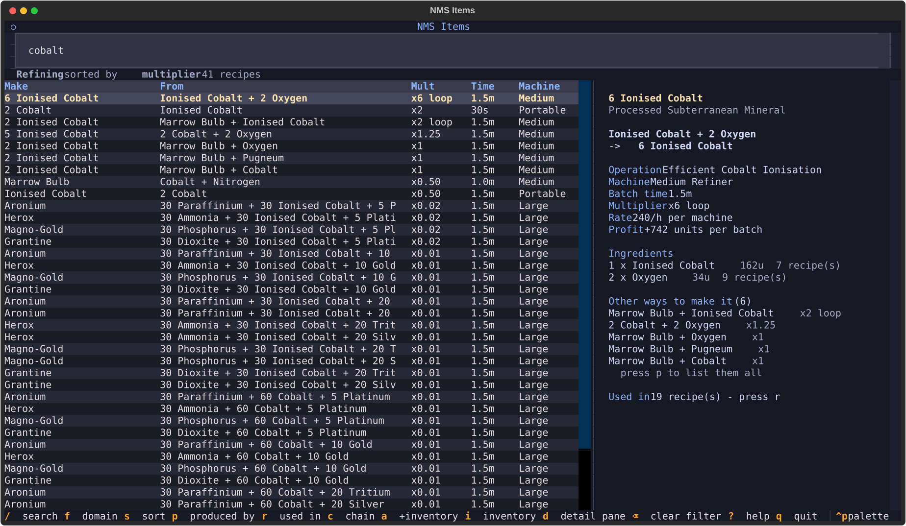
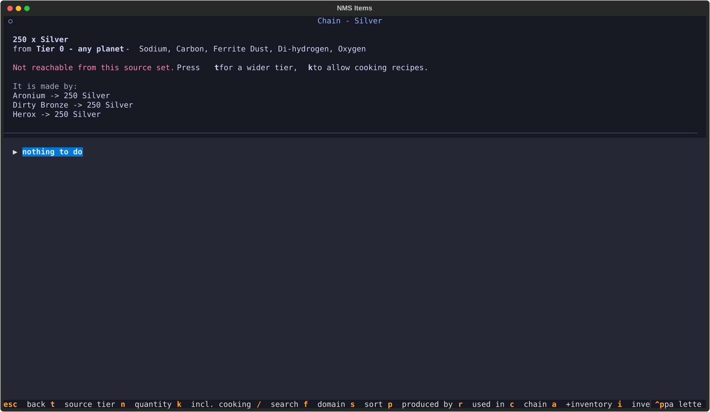
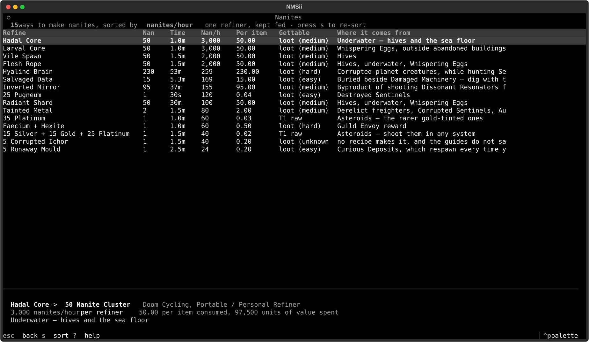
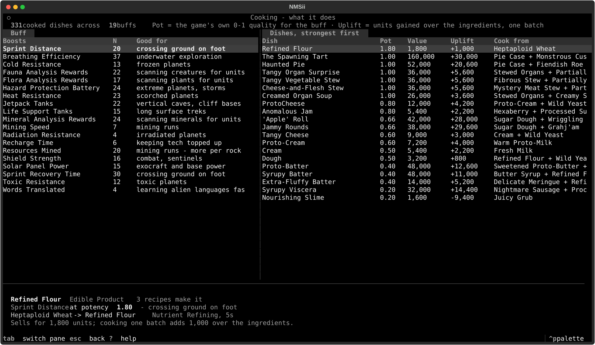
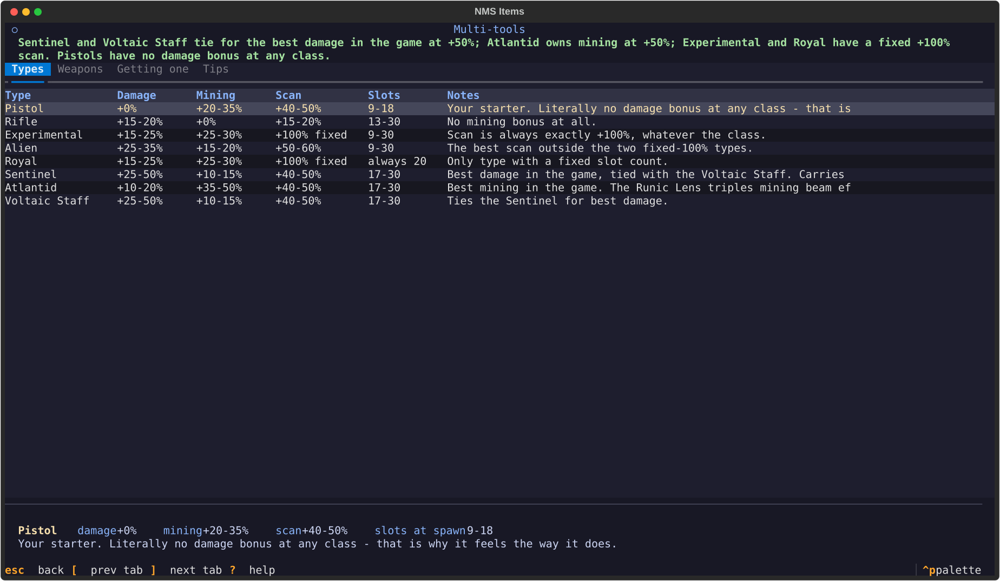
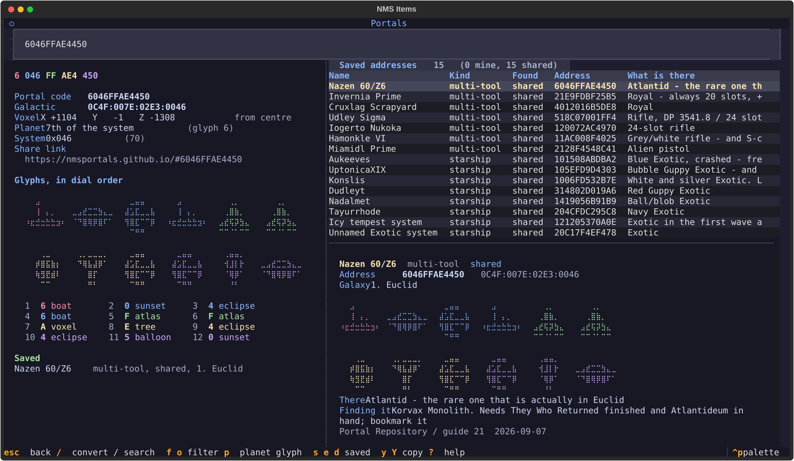
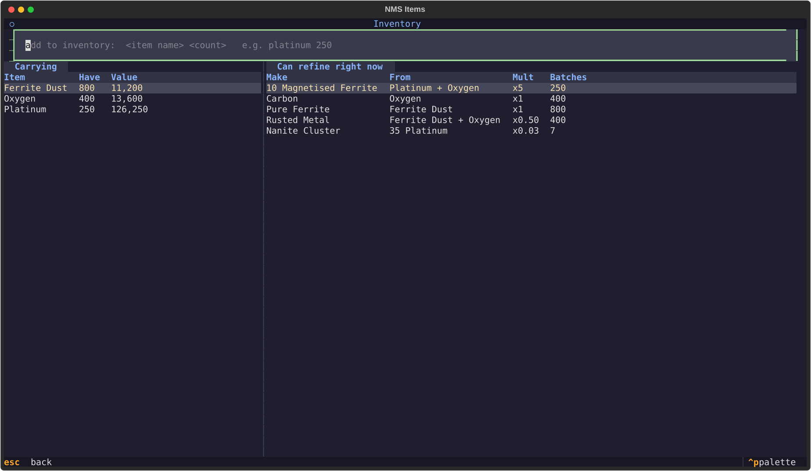

# NMS Items — No Man's Sky refining & cooking, in the terminal

A **TUI** for the two lookups you actually make while playing: *what does this
refine into*, and *how do I get that from what I'm carrying*. Plus a printable
**cheat sheet** of the recipes worth memorising.

Every number comes from the game's own recipe table — 357 refining and 1,323
cooking recipes — not from a wiki transcription. The written guides this grew
out of live in the Suika Box vault under `01.projects/03.no-mans-sky/`;
[`20.refiner-recipes.md`](../../Documents/Suika%20Box/01.projects/03.no-mans-sky/20.refiner-recipes.md)
is the prose version of what this app queries.



---

## What's inside

| | |
| --- | --- |
| ⌨️ **`nms`** | The TUI: fuzzy search, reverse lookup, chain planning, inventory. `mise run tui` |
| 🖨️ **Cheat sheet** | Three-page landscape A4 ([Typst](https://typst.app)) — the money engine, the nanite ladder, the kitchen. Catppuccin **Latte** for print and **Mocha** for screens. `mise run pdf` |
| 🧮 **Recipe graph** | Chain planner that answers "cheapest way to N of X from things I can pick up" — the same graph walk that produced the Tier 0/1/2 lists in the notes |
| 💠 **Nanite ladder** | Every route to nanites ranked by nanites/hour, with how gettable each input is and where it drops |
| 🍳 **Cooking buffs** | What each dish does when you eat it, per stat, with what it sells for |
| 🔫 **Multi-tools** | The 8 types compared, the 5 weapons measured, and how to get the free S-class ones |
| 🌀 **Portal addresses** | Glyphs ↔ galactic coordinates, offline, plus the addresses from the guides — where the good tools and Exotics are |
| 📦 **Inventory** | Type what you're carrying; see what refines right now and what you're one ingredient short of |

---

## Using it

```fish
mise install        # uv + typst
mise run setup      # fonts for the PDF (paru)
mise run sync       # python deps
mise run tui        # go
```

### Keys

`Ctrl+P` opens the **command palette**, which lists every mode the app has by
name and marks the one you are in:

```
● Recipes: Refining          ● Sort: multiplier        Nanite ladder
· Recipes: Cooking           · Sort: fastest           Portal addresses
· Recipes: All recipes       · Sort: units profit      Inventory
```

Type `profit` and press Enter to sort by profit; `shared` to filter saved
addresses to the ones other people found. Cycle keys are faster once you know
the order and opaque until you do — pressing `s` four times reaches "units
profit", but nothing on screen ever said that was an option. The palette is
also what lets the footer group its keys: nothing is hidden by being left out
of the bar.

Vim motions work in every table, tree and scrollable pane:

| | |
| --- | --- |
| `j` `k` | down / up · `h` `l` pan a wide table sideways |
| `g g` `G` | top / bottom · `ctrl+d` `ctrl+u` half page |
| `/` | search — **insert mode**: type freely, `Esc` or `Enter` returns to normal mode |
| `Esc` | in normal mode, clears the search and any filter |

Then the actions:

| | |
| --- | --- |
| `f` `s` | cycle domain (refining / cooking / all) and sort — or pick either by name from `Ctrl+P` |
| `p` `r` | recipes that **produce** the highlighted item / that **consume** it |
| `Enter` | pivot to everything touching that item · `Backspace` clears the filter |
| `c` | **chain plan** it — inside: `t` source tier, `n` quantity, `C` allow cooking |
| `n` | the **nanite ladder** — every route to nanites, ranked |
| `e` | **cooking effects** — what each dish does when eaten |
| `m` | **multi-tools** — types, weapons, getting one, tips |
| `P` | **portal addresses** — convert glyphs, and the places worth going |
| `a` `i` | add to inventory / open the inventory screen (`/` opens its add field) |
| `d` | show/hide the detail pane — it hides itself below 100 columns |
| `?` | full help |
| `ctrl+p` | command palette — every mode by name |

### Reading the columns

- **Mult** — units out per unit in. `x6 loop` means the recipe feeds itself:
  `1 Chlorine + 2 Oxygen → 6 Chlorine` multiplies the seed six times, which is
  the only kind of recipe that grows a stack out of nothing.
- **Time** — one batch, from the game files. The in-game display is often wrong.
- **Machine** — Portable/Personal (1 input), Medium (2), Large (3).
- **Rate / Profit** — units per hour with one machine kept fed, and the
  base-value difference across one batch. Profit is in units and says nothing
  about nanites; those get their own screen.
- **Gettable** — how reachable the hardest ingredient is. `T0/T1/T2 +n` means
  refinable from surface materials / asteroids / an atmosphere harvester, `n`
  refining steps away. `needs seed` means refinable but wanting a material none
  of those tiers contain — a stellar metal, typically, of which you need two
  units ever. `loot (...)` means no recipe makes it.

### The chain planner

Pick any item, press `c`, and it works backwards to a source set — by default
the five things you can pick up on any planet (Oxygen, Carbon, Ferrite Dust,
Di-hydrogen, Sodium), `t` widens that to asteroids and then an atmosphere
harvester. The cost it minimises is **refiner-seconds per unit**, so the plan is
the one that ties up a machine for the least time, not merely the shortest one.



If nothing reaches the target it says so and lists what the item *is* made
from — that is how you find out something has to be looted rather than refined.

### Nanites

Nanites are the second currency, and a units column is actively misleading
about them: one Salvaged Data is ~51,000 units *or* 15 nanites. Press `n` for
every route to nanites ranked by nanites/hour per refiner — which reproduces
the guide's finding that Larval and Hadal Cores (3,000/h) beat the headline
230-nanite Hyaline Brain (259/h) twelvefold, and that Runaway Mould is the
slowest converter in the game at 24/h.

Each row also carries how gettable the input is and where it drops.



### Cooking

Eat or sell? Both, in that order. Every cooked product grants a temporary buff
*and* multiplies base value several times over, so the dish you eat is the dish
you sell — cook the batch, eat one, sell the rest. Press `e` for the 19 buffs
and the strongest dishes for each, with what they sell for and what one batch
adds over its ingredients.



### Multi-tools

Four tabs: the 8 types side by side, the 5 primary weapons with their measured
best hit, where each rare type comes from (three of them free — the Harmonic
Camp puzzle, Sentinel Pillars, Korvax Monolith interfaces), and the tips that
matter: adjacency is horizontal and vertical only, supercharged slots want a
2×2 block, and Damage Potential is not damage output.



### Portal addresses

Press `P`. One box does both jobs: paste a **portal code** (twelve hex digits,
one per glyph), a **galactic address** (`0824:007F:00F3:01AC`, what a signal
booster shows) or a nmsportals.github.io link and it converts as you type —
type anything else and it searches the addresses you have saved.



It is [nmsportals.github.io](https://nmsportals.github.io/) offline, with the
same constants:

```
galactic X = (portal X + 2047) % 4096      portal X = (galactic X + 2049) % 4096
galactic Y = (portal Y +  127) %  256      portal Y = (galactic Y +  129) %  256
galactic Z = (portal Z + 2047) % 4096      portal Z = (galactic Z + 2049) % 4096
```

The two frames disagree only about where zero is — portal coordinates count
from the **centre** of the galaxy, galactic ones from a corner — which is the
whole reason the same place has two unrecognisably different addresses. The
test suite pins that on the one fact both agree about: portal `000000000000`
is the galaxy centre, and galactic coordinates call it `07FF:007F:07FF`.

An address reads `p SSS YY ZZZ XXX` — planet, system index, then the voxel as
height, width, length. The screen colours each field in the code and in the
glyph list, so it is obvious which three glyphs are X.

🔑 **The hex digit is the position on the dial.** The 16 glyphs sit in a fixed
order, `0`–`9` then `A`–`F`, so `A` is the eleventh symbol, every time — and
you need all 16 unlocked, not twelve.

| | |
| --- | --- |
| `y` `Y` | copy the portal code / the galactic address |
| `s` `e` `d` | save what is converted, edit it, drop it |
| `f` `o` | filter the saved list by kind / by who found it |
| `p` | change the planet glyph — the one a galactic address cannot carry |
| `Enter` | on a saved row, loads it back into the converter |

#### Mine, and shared

Every saved address is one of two kinds, and `o` cycles between them:

| | |
| --- | --- |
| **mine** | you stood there. Stamped with the date you saved it. The default when you press `s` |
| **shared** | off a catalogue or from a friend |

That split is worth more than it looks. What is verified in a catalogue entry
is the **address** — the location is seeded to the coordinate and generally
survives a patch. The class, the slot count and the headline damage figure are
somebody else's claim about somebody else's save, and those rot. Your own finds
are the ones you can vouch for.

The saved addresses live in `data/locations.json`, committed alongside the
guides they came from rather than hidden in XDG state, because they are
findings: they diff, review and share like everything else here. Press `s` to
add one through a form, or edit the file directly — it carries its own schema.
It ships with the fifteen from the Euclid shortlists in guides
[21](../../Documents/Suika%20Box/01.projects/03.no-mans-sky/21.multitool-damage.md)
and [14](../../Documents/Suika%20Box/01.projects/03.no-mans-sky/14.starships-ranked.md)
— seven multi-tools and eight Exotic starships, read off the Portal Repository
in September 2026, all marked `shared`. From the multi-tool screen, `P` opens
the list already filtered to tools.

### Inventory



---

### The cheat sheet

`mise run pdf` writes `docs/pdf/nms-cheatsheet.pdf` (Latte, for print) and
`nms-cheatsheet-dark.pdf` (Mocha, for screens):

1. **Money engine** — the ×6 loops, the precious-metal engine, best profit per
   batch and per machine-hour, the six refiner rules.
2. **Nanites** — every converter with where its input drops, then the
   essentials you should stop mining, and what Tier 0 / Tier 1 reach.
3. **Kitchen** — top dishes by value, then all 19 buffs with their three best
   dishes each.
4. **Multi-tools** — the 8 types, the weapons measured, how to get the free
   ones, and the adjacency and supercharged-slot rules.
5. **Portals** — all 16 glyphs in dial order, how to read an address, the
   conversion both ways, and every saved address in two tables: the ones you
   found and the ones you were told about.

It is generated from `data/cheatsheet.json`, so it cannot drift from the app —
including its own prose: claims like "every row below is 5s in the Processor"
are re-checked against the rows on each build and disappear if they stop being
true. The portals page goes further: `mise run pdf` round-trips every address
and re-checks the galaxy-centre invariant, so the build fails rather than
printing a code you cannot dial.

## Where the data comes from

[NMS-Handbook](https://github.com/ApexFatality93/NMS-Handbook) parses
`NMS_REALITY_GCRECIPETABLE.MXML` straight out of the game files into JSON.
`scripts/fetch_source.py` pulls four of its tables into `.cache/` (gitignored)
and `scripts/build_data.py` flattens them into the two committed files the app
reads:

| | |
| --- | --- |
| `data/items.json` | 693 items — name, category, rarity, base value, and for cooked food the stat it buffs and how strongly |
| `data/recipes.json` | 1,680 recipes — flat, with ratio, loop multiplier, batch time, profit and rate precomputed |
| `data/cheatsheet.json` | the subset the PDF prints |
| `data/acquisition.json` | **hand-written** — where loot comes from, since the game files record what a recipe needs but never where to find it. Taken from the guides; where they say nothing, the app says "unknown" rather than guessing |
| `data/multitools.json` | **hand-written** — the multi-tool reference. The game files carry nothing useful about multi-tools, so this comes wholesale from guides 05 and 21 |
| `data/locations.json` | **hand-written** — portal addresses, from the Euclid shortlists in guides 14 and 21, plus whatever you find. The `s` key on the portal screen appends to it |

After a game patch:

```fish
mise run refresh    # fetch → normalise → re-pick the cheat sheet → rebuild PDFs
mise run test       # 13 checks, including the numbers the written guides assert
```

The test suite is the point of that second command: it asserts the claims the
notes make — the three ×6 loops, Living Pearl → 100 Gold, Tier 0 reaching
exactly 30 materials, the 25 items no recipe produces, Larval Cores at 3,000
nanites/hour against Runaway Mould's 24 — so if upstream or the game moves a
ratio, it fails loudly instead of quietly printing a wrong sheet.

---

## Tasks

| Task | Does |
| --- | --- |
| `mise run tui` | the app |
| `mise run dev` | the app with live CSS reload, for editing `app.tcss` |
| `mise run web` | serve it in a browser on `:8000` |
| `mise run pdf` | both cheat-sheet PDFs into `docs/pdf/` |
| `mise run pdf-watch` | rebuild the light PDF on every save |
| `mise run refresh` | full data rebuild from upstream |
| `mise run test` | pytest — data integrity + a headless pass over the TUI |
| `mise run screenshot` | regenerate the SVGs in this README |

---

## Layout

```
src/nms_items/
  model.py     items, recipes, the forward/reverse indexes, search
  graph.py     chain planning (Knuth's AND-OR Dijkstra), reachability, the nanite ladder
  ease.py      how gettable an item is: tier, chain depth, raw breadth, loot notes
  food.py      cooked dishes grouped by the buff they grant
  multitools.py  the hand-written multi-tool reference, loaded from data/
  portals.py   glyphs <-> galactic coordinates, and the saved addresses
  inventory.py what you're carrying, persisted to XDG state
  app.py       the recipe table + detail pane
  screens.py   chain, nanites, cooking, multi-tools, portals, inventory, help
  widgets.py   the vim-keyed DataTable, Tree, scroll pane and search box
scripts/       fetch, normalise, pick cheat-sheet rows, screenshots
cheatsheet.typ the PDF
```
