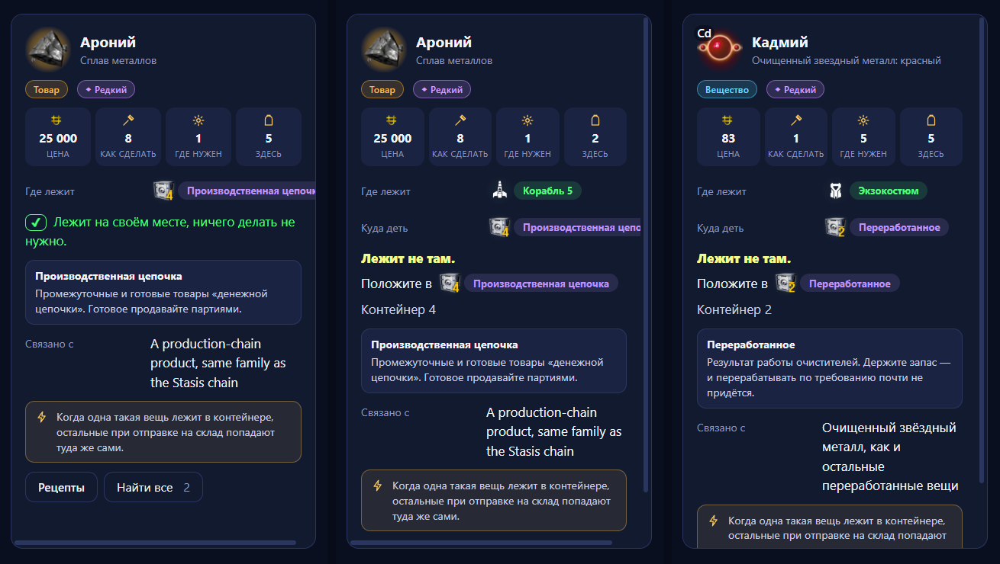
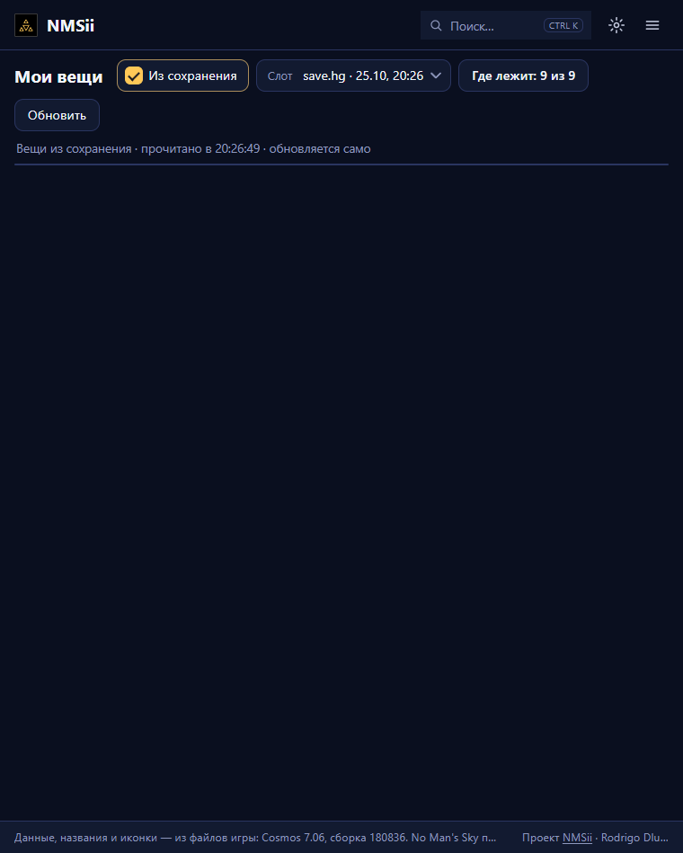
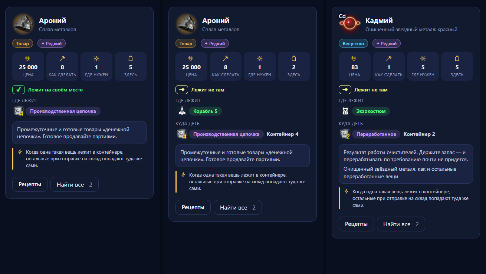

# The item card of "My items": a design review

Date: 2026-10-25. What was looked at: the card on the right of the "I have" table in four states.
The screenshots were taken in Chrome on the real build (`dist`) with a test save; the sizes and figures below were measured
in the page (`getBoundingClientRect`), not estimated by eye. The fixes are **not made**: below are only findings and
suggestions.

(The Russian original of this review is in [ru/inventory-card-review.md](ru/inventory-card-review.md); the item and place
names in the screenshots are in Russian.)

| State | What is open | Screenshot |
|---|---|---|
| A. In its place | Aronium in "Production chain" (container 4) | left of `cards-ok-ship-suit.png` |
| B. Wrong place, ship | Aronium in "Ship 5" | in the middle |
| C. Wrong place, exosuit | Cadmium in the exosuit | right |
| D. Narrow window (760 px) | the whole page | `narrow-760px.png` |
| E. Typed by hand | Nitrogen, no save | `card-manual.png` |

---

## Gross errors (they break use)

### G1. In a window narrower than 1000 px the table and the card vanish altogether

- **Fact.** At a width of 760 px under the hint row there is nothing: the table is 2 px high, the whole grid 38 px (measured).
  No items are on screen at all; this is not "inconvenient" but "the page is empty".
- **Cause.** [Inventory.svelte](site/src/views/Inventory.svelte) (`.grid3`, the `max-width: 1000px` media query) turns the grid
  into one column, but the global rules `main > .grid3 { flex: none }` and `.grid3 .list { flex: 1 1 0; height: auto; min-height: 0 }`
  ([app.css](site/src/app.css) lines 72–74) stay, and a grid row `minmax(0, 1fr)` with no set height gives zero.
- **Fix.** In the same media query give the table a height like the `.split` of the Craft and Wiki pages
  (`.grid3 .list { height: 60vh; flex: none }`), the grid rows `grid-template-rows: none`, and the card `height: auto`.
  Test: windows of 760 and 440 px, the table visible, the card under it.

### G2. The place tag is cut off by the edge of the card

Seen on A and B: "Production chain" runs past the right edge and has no rounded end.

- **Fact.** The tag sticks out past the block's edge by 21 px (A and B). Short tags ("Exosuit", "Ship 5") fit.
- **Cause.** The "Where it lies / Where to put it" row is a `dl` with a 148 px label column ([app.css](site/src/app.css) line 272);
  about 250 px are left for the tag, while the 36 px icon plus the `white-space: nowrap` tag come to about 270 px.
  [StorageNote.svelte](site/src/components/StorageNote.svelte), `.where`.
- **Fix.** The label above the value (one column) or a 96 px label column; let the tag wrap, or give it
  `max-width: 100%` with an ellipsis. Any solution has to be checked with the longest name in the scheme
  ("Production chain", "Upgrades & tech").

### G3. The main buttons went past the bottom edge of the card

- **Fact.** "Recipes" and "Find all" on cards B and C lie 29 and 75 px below the visible area, so the card has to be scrolled
  inside. On card A they fit with 61 px to spare, so the position of the buttons depends on whether the item lies right or not.
- **Why this is gross.** "Find all" is needed exactly for an item lying in several places, and those are the longest cards.
- **Fix.** Move the buttons up (right under the tiles with the figures) or pin them to the bottom of the card
  (`position: sticky; bottom: 0`); and shorten the content (see S1–S3) so that everything fits into 700 px.

---

## Serious shortcomings (it reads badly, it looks sloppy)

### S1. The same thing is written three times

On B and C the name of the right place is repeated: the tag in the "Where to put it" row, the tag in "Put it in [tag]", the
heading of the grey block.
- **Fix.** Keep one pair: the "Where to put it" row with the tag and a "Container N" caption beside it, and under it the grey block
  with the description of the place (without the name again in its heading). Remove the "Put it in…" row: its meaning is already in
  the "Where to put it" row and in the yellow caption "It lies in the wrong place".

### S2. "Container N" is cut off from the tag and stands on a line of its own

- **Fact.** On B, C and E "Container 4" / "Container 2" / "Container 1" wraps onto a third line and hangs under the word "Put".
- **Cause.** `.go { flex-wrap: wrap }` and the large 17 px font.
- **Fix.** Make the number part of the tag (the crate icon already carries a digit) or put it right after the tag in small grey
  text on the same line without wrapping.

### S3. Three different text sizes in one card, the text scatters

- **Fact.** "Put it in" and the value of "Related to" are 17 px, the hint, the grey block and the labels 14 px, the tag 13 px (measured).
  "Related to" stands in a narrow right column and wraps to 3–4 lines in a large white font, drawing more attention than the main
  action.
- **Besides.** The value ("A production-chain product, same family as the Stasis chain") was in English: an untranslated data string
  that stuck out of a Russian interface.
- **Fix.** Bring everything to one scale (main 14 px, secondary 12–13 px); drop "Related to" into the grey block as a second
  paragraph, and translate or hide the English strings; keep the large white font only for the heading of the card.

### S4. "It lies in the wrong place." shouts too much and is not tied to the arrow in the table

- **Fact.** A poisonous-yellow font of weight 800 on a line of its own with no icon; in the table the same message is a frame with ➜.
- **Fix.** The same language as in the table: a 24 px frame with ➜ and the text "It lies in the wrong place" at weight 600 on one
  line with the status; put it at the top of the block, before the "Where it lies / Where to put it" rows.

### S5. The line "It lies in its place…" wraps with no indent

- **Fact.** A ✔ frame and bright lime text, the second line "needed." goes under the frame (A).
- **Fix.** Flex with a fixed-width frame and the text aligned to the first line; shorter text ("In its place") and more muted;
  bright green only on the ✔.

### S6. The grey block and the yellow hint weigh almost the same and are muddy in colour

- **Fact.** The same borders, radius and padding; the hint's background (9% of the accent) gives a dirty brown on the dark, and the grey
  text on it reads poorly. The hint about the container is shown on every container card, so it is almost always noise.
- **Fix.** Keep the grey block as "about the place"; make the hint a compact line with an icon and no frame, or move it from the card
  into a tooltip on the "Where it lies" row; if the frame stays, use a neutral blue/accent tone with enough contrast (≥ 4.5:1).

---

## Small remarks

- **M1. The 148 px label column takes 37% of the card's width.** On A the value starts a third of the way in, and the right part is empty
  or cut. A label above the value gives the tag 100% of the width (see G2).
- **M2. The tag "Raw - planetary" (E) is two-toned to the eye.** The word after the dash looks bolder and brighter than the first part.
  The font/kerning should be checked and brought to one style.
- **M3. Emptiness at the bottom of the manual card (E).** The card stretches to the full height of the pane, with about 200 px empty under the
  "Recipes" button. Better a height to fit the content, leaving the free room to the page's background.
- **M4. The place icon beside the tag and the large "Put it in" text sit on different lines.** After moving to the single font
  scale (S3), align them to the centre of the row.

---

## What is good in the card (keep)

- The header (a 60 px icon, the name, the subtitle) and the row of four tiles are the same as in Craft and Wiki.
- The "here" tile instead of "you have" for a row with a place, and the type and rarity tags as links.
- The place icons: clear and handsome, the same in the table and in the card.

## Order of fixes

1. G1 (a window narrower than 1000 px: the page is empty), 2. G2 + M1 (tags are not cut), 3. G3 + S1 + S2 (the card fits, the buttons
are in view), 4. S3 + S4 + S5 + S6 (one text scale and one language of statuses), 5. M2–M4.

Check after the fixes: windows of 440, 760, 1500 and 1900 px; the longest tag; an item in one place and in four; typing by hand and saving.

---

## Status of the fixes (2026-10-25)

Fixed in the same order as suggested above; checked by measurements in Chrome (windows of 1500, 760, 440 px) and by the tests in
`tests/test_inventory_spec.py`.

| Item | Result |
|---|---|
| G1 empty page in a narrow window | Fixed. 760 px: the table is 569 px (13 rows), the card under it 462 px; 440 px: the table 540 px, the card 500 px. |
| G2 tag cut off | Fixed. The label is above the tag; the longest tag is now 143 px short of the card's edge (it used to stick out by 21 px). In a narrow window, and where it still does not fit, the name ends in an ellipsis inside the tag. |
| G3 buttons past the edge | Fixed. The buttons are pinned to the bottom of the card, in view in all three states; the cards are no taller than the pane (518, 580, 625 of 702 px). |
| S1 repeats | Fixed. There is one "Where to put it" tag; the "Put it in…" line and the grey block's heading are gone. |
| S2 "Container N" on its own line | Fixed. It stands on one line with the tag and does not wrap. |
| S3 three font sizes, English text | Fixed. Only 14 px and 13 px; "Related to" moved into the grey block as a second paragraph; a reason written only in English is not shown. |
| S4, S5 status | Fixed. The status stands at the top in the table's frame: a green ✔ "It lies in its place", a yellow ➜ "It lies in the wrong place", text 14 px/600. |
| S6 grey block and hint | Fixed in part. The hint has no frame or background (a bar on the left and an icon) and does not compete with the grey block. It is still shown on every container card: whether to remove it altogether is the owner's call. |
| M1 148 px label column | Fixed together with G2. |
| M3 emptiness at the bottom of the card | Fixed: the height fits the content. |
| M2 two-toned tag "Raw - planetary" | Not looked into separately: after the fixes the tag is drawn by the same component, but the cause (font/kerning) was not found. |
| M4 alignment of "Put it in" and the tag | Dropped: the "Put it in…" line is gone. |
