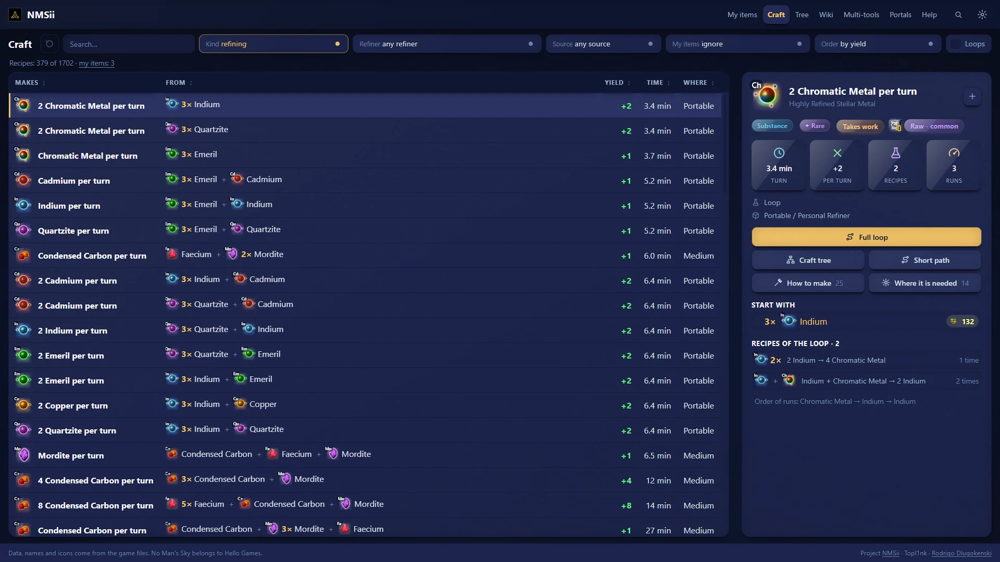
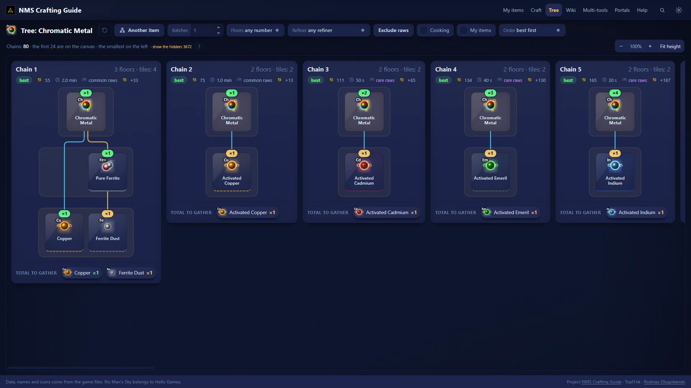
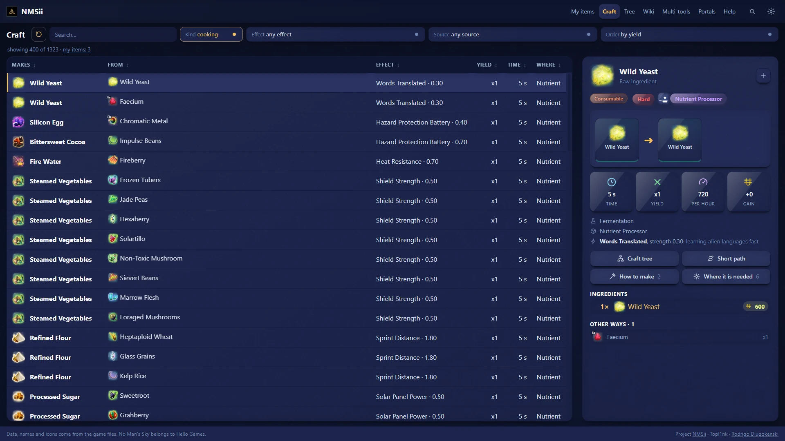
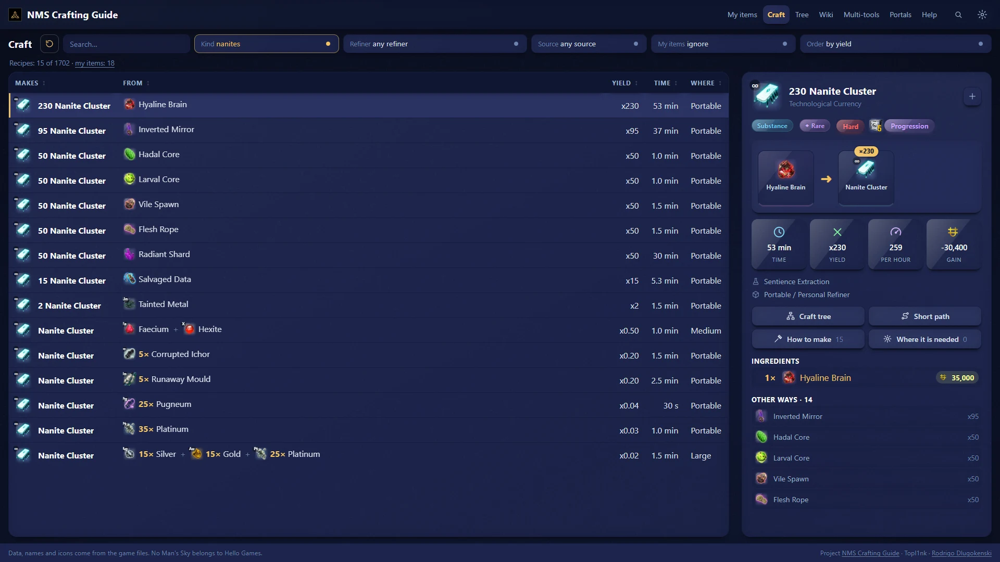
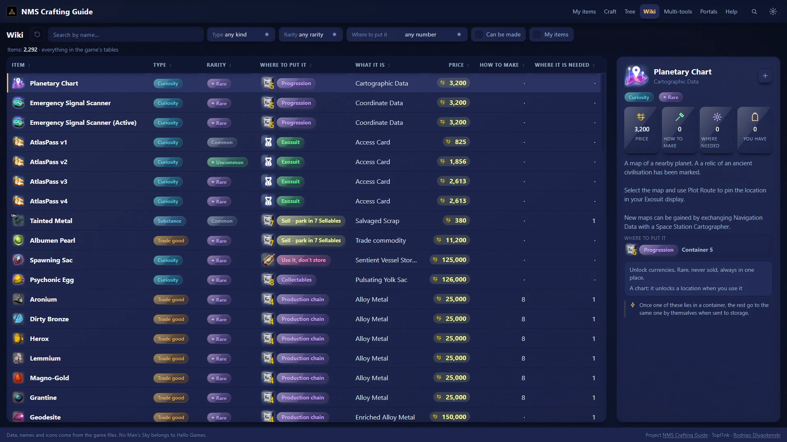
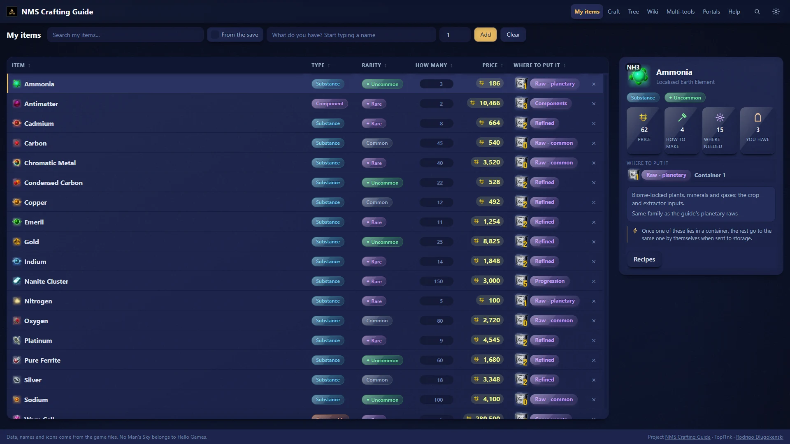
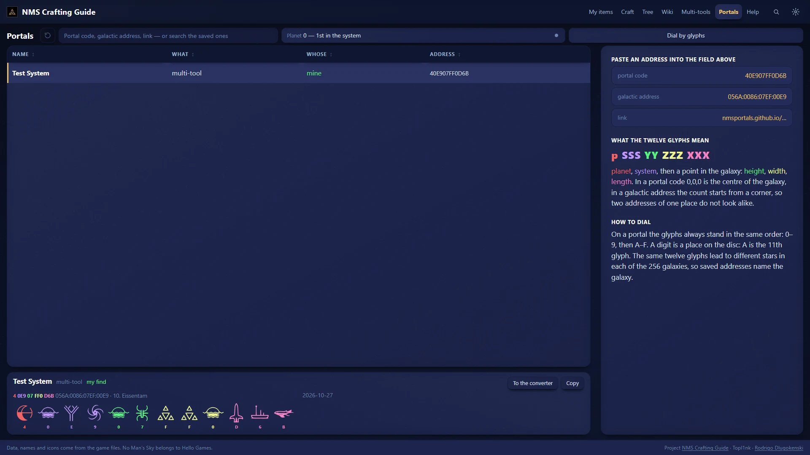
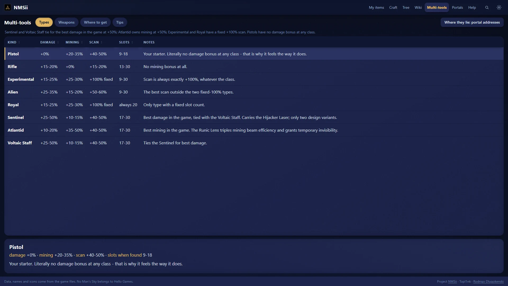
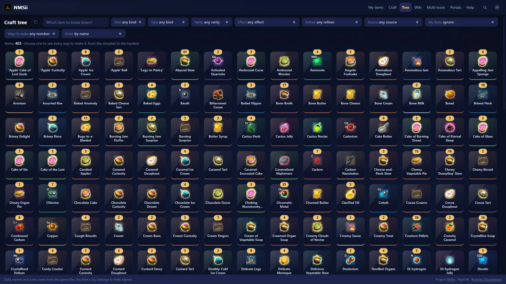

  
  
  

  
  
  
  

[English](../../README.md) · [Русский](README.ru.md) · [Português (Brasil)](README.pt-BR.md) · [Português](README.pt.md) · **Español** · [Français](README.fr.md) · [Deutsch](README.de.md) · [Italiano](README.it.md) · [Nederlands](README.nl.md) · [Polski](README.pl.md) · [日本語](README.ja.md) · [한국어](README.ko.md) · [简体中文](README.zh-CN.md) · [繁體中文](README.zh-TW.md)

## ¿Qué es?

Estás ante un refinador y te preguntas: *¿en qué se convierte esto y cuál es la forma más rápida de conseguir ese objeto con lo que llevo encima?* NMS Crafting Guide responde en un par de clics.

Es un programa pequeño para tu ordenador. Lee recetas, precios y nombres **directamente de tu propia copia del juego**, así que las cifras son las que el juego usa de verdad, y no las que una wiki recordaba de un parche antiguo.

- 🧪 **Todas las recetas en una tabla.** Refinado, cocina y rutas de nanitos. Ordena por rendimiento, tiempo o beneficio.
- 🌳 **Todas las formas de hacer un objeto,** dibujadas como un árbol, de la más sencilla a la más difícil.
- 🍲 **¿Comer o vender?** Encuentra el plato con el efecto que necesitas y mira por cuánto se vende.
- 📦 **¿Dónde se guarda?** Cada objeto con el almacenamiento al que pertenece.
- 🔁 **Bucles de dinero.** Recetas que se alimentan entre sí y te dejan con más de lo que pusiste.
- 🔭 **Direcciones de portal.** Escribe un código en cualquier forma y mira los glifos que marcar.
- ⚔ **Multiherramientas** comparadas una al lado de otra, y cómo conseguir las buenas.
- ️ **17 idiomas,** los mismos del juego. Los nombres de los objetos también cambian con el idioma.
- 🌍 **Privado.** Nada sale de tu ordenador. Sin cuenta y sin internet tras el primer arranque.

## Instalación

| | |
| --- | --- |
| **Windows** | Descarga `nms-crafting-guide-Setup-….exe` de la [última versión](https://github.com/Topl1nk/nms-crafting-guide/releases/latest) y ejecútalo. No hacen falta permisos de administrador. El instalador habla 14 idiomas. |
| **Linux** | Descarga `nms-crafting-guide-….AppImage`, hazlo ejecutable y haz doble clic. |

Windows puede mostrar *"Windows protegió su PC"*, porque el programa es nuevo y no está firmado. Pulsa *Más información → Ejecutar de todas formas*.

**Primer arranque.** NMS Crafting Guide encuentra tu No Man's Sky (Steam o GOG) y toma de él las imágenes de los objetos. Tarda unos minutos y ocurre una sola vez. Al cambiar a un idioma aún no preparado, el primer cambio tarda como un minuto y luego los nombres cambian al instante. Las imágenes y los textos se quedan en tu ordenador; pertenecen a Hello Games y nunca se suben.

## Un vistazo

<table>
  <tr>
    <td width="50%"> <b>Árbol de fabricación.</b> Todas las formas de hacer un objeto y qué reunir.</td>
    <td width="50%"> <b>Cocina.</b> Los mejores platos para el efecto que quieres.</td>
  </tr>
  <tr>
    <td width="50%"> <b>Nanitos.</b> Todas las rutas, por nanitos a la hora.</td>
    <td width="50%"> <b>Wiki.</b> Todos los objetos del juego con su ficha.</td>
  </tr>
  <tr>
    <td width="50%"> <b>Mis objetos.</b> Lo que llevas y dónde va cada cosa.</td>
    <td width="50%"> <b>Portales.</b> Códigos y direcciones, con los glifos dibujados.</td>
  </tr>
  <tr>
    <td width="50%"> <b>Multiherramientas.</b> Ocho tipos comparados y cómo conseguir las mejores.</td>
    <td width="50%"> <b>Elige cualquier objeto</b> que se pueda fabricar y mira cómo.</td>
  </tr>
</table>

## Conviene saber

- **Claro u oscuro,** cualquier color de acento, texto más grande, iconos brillantes. Todo en el menú de ajustes.
- **Camino corto.** Elige un objeto y NMS Crafting Guide encuentra cómo hacerlo con cosas que se recogen en cualquier planeta, con el plan que menos ocupa el refinador.
- **Tras una actualización del juego** la aplicación puede volver a leer las cifras de tu juego, así que nunca se quedan viejas.
- **Hoja de consulta para imprimir** con las recetas que merece la pena memorizar, en `docs/pdf/`.

## Créditos

- Aplicación de escritorio e interfaz: **[Topl1nk](https://github.com/Topl1nk)**
- Núcleo, recetas y datos: **[Rodrigo Dlugokenski](https://github.com/rdlu)**, [nms-items-interface](https://github.com/rdlu/nms-items-interface)

NMS Crafting Guide empezó como un fork de [nms-items-interface](https://github.com/rdlu/nms-items-interface), de Rodrigo Dlugokenski, y desde entonces se ha reconstruido: páginas nuevas, aplicación de escritorio, los 17 idiomas y datos leídos del juego actual. Los glifos de portal están calcados de [nmsportals](https://nmsportals.github.io/).

*No Man's Sky*, con todos sus nombres, imágenes y textos, pertenece a Hello Games; este es un proyecto de fans no oficial. Licencia [GPL-3.0](../../LICENSE). ¿Quieres compilarlo o cambiarlo? Mira [docs/DEVELOPERS.md](../DEVELOPERS.md) (en inglés).

  

