

  
  
  

  
  
  
  

[English](../../README.md) · [Русский](README.ru.md) · [Português (Brasil)](README.pt-BR.md) · [Português](README.pt.md) · [Español](README.es.md) · [Français](README.fr.md) · [Deutsch](README.de.md) · [Italiano](README.it.md) · [Nederlands](README.nl.md) · [Polski](README.pl.md) · **日本語** · [한국어](README.ko.md) · [简体中文](README.zh-CN.md) · [繁體中文](README.zh-TW.md)

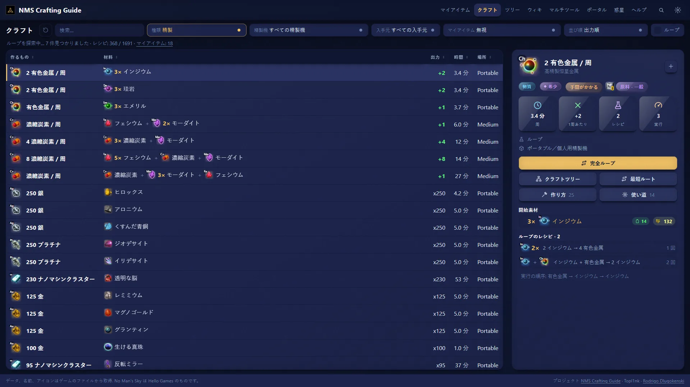

## これは何?

精製機の前で、こう思ったことはありませんか。*これは何になる? 手持ちの素材でそのアイテムを一番早く手に入れるには?* NMS Crafting Guide なら数クリックで答えが出ます。

あなたのパソコンで動く小さなプログラムです。レシピ、価格、名前を**手元のゲームから直接**読み取るので、古いパッチをうろ覚えしたWikiではなく、ゲームが実際に使っている数値が出ます。

- 🧪 **すべてのレシピを一つの表に。** 精製、料理、ナナイトの入手ルート。収量・時間・利益で並べ替えられます。
- 🌳 **アイテムの作り方をすべてツリーで表示。** 一番簡単な方法から一番難しい方法まで。
- 🍲 **食べる? 売る?** 欲しい効果の料理を探し、売値も確認できます。
- 📦 **どこに入れる?** 各アイテムにふさわしい収納先を表示します。
- 🔁 **お金のループ。** 互いに材料を回し合い、元手より多く残るレシピ。
- 🔭 **ポータルアドレス。** どんな形式のコードでも入力すれば、入力するグリフが表示されます。
- 🪐 **惑星。** セーブデータから、訪れた惑星を一覧表示します：ポータルアドレス、見つけたもの、拠点、そして各惑星にあるもの（天候、センチネル、植物、動物、資源）。絞り込みもでき、Wikiから資源のある惑星へ移動できます。
- ⚔️ **マルチツール** を並べて比較し、良いものの入手方法も紹介します。
- 🌍 **17言語対応。** ゲームと同じ言語です。アイテム名も言語に合わせて変わります。
- 🔒 **プライバシー重視。** データはあなたのパソコンの外に出ません。アカウント不要で、初回起動後はネット接続も不要です。行う通信は、新しいバージョンがあるかをGitHubに尋ねる1回だけです。

## インストール

| | |
| --- | --- |
| **Windows** | [最新リリース](https://github.com/Topl1nk/nms-crafting-guide/releases/latest)から `nms-crafting-guide-Setup-….exe` をダウンロードして実行してください。管理者権限は不要です。インストーラーは14言語に対応しています。 |
| **Linux** | `nms-crafting-guide-….AppImage` をダウンロードし、実行権限を付けてダブルクリックします。 |

> [!NOTE]
> 新しく署名もないプログラムのため、Windows に *「WindowsによってPCが保護されました」* と表示されることがあります。*詳細情報 → 実行* を押してください。

> [!IMPORTANT]
> **初回起動。** NMS Crafting Guide はインストール済みの No Man's Sky(Steam または GOG)を見つけ、アイテム画像を取り込みます。数分かかりますが、一度だけです。画像とテキストはあなたのパソコンに残り、Hello Games のものとして、アップロードされることはありません。

> [!TIP]
> まだ準備されていない言語に切り替えると、最初の切り替えに約1分かかり、その後すぐに名前が変わります。

## 画面を見てみる

<table>
  <tr>
    <td width="50%">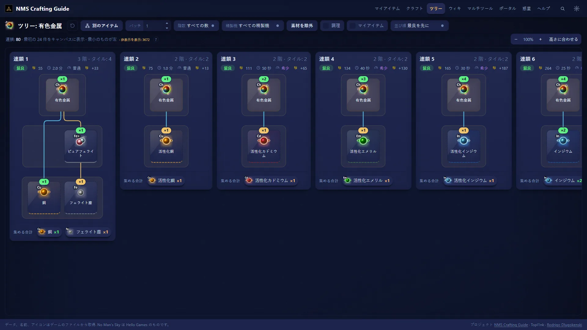 <b>クラフトツリー。</b> アイテムの作り方と集める素材。</td>
    <td width="50%">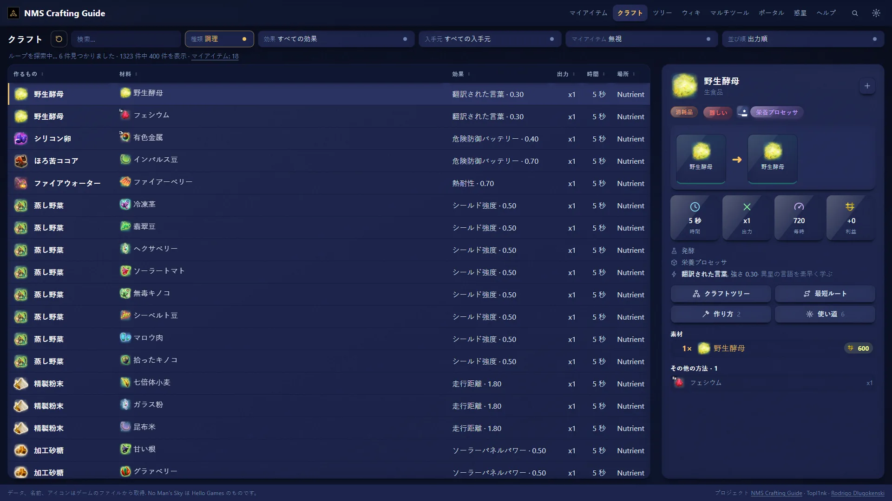 <b>料理。</b> 欲しい効果に最適な料理。</td>
  </tr>
  <tr>
    <td width="50%">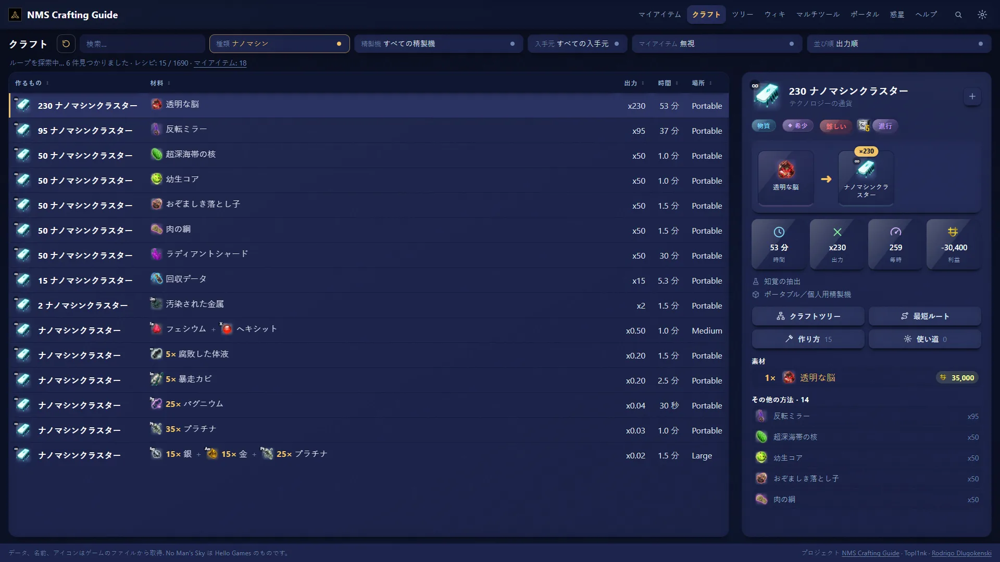 <b>ナナイト。</b> 1時間あたりのナナイトで並べた全ルート。</td>
    <td width="50%">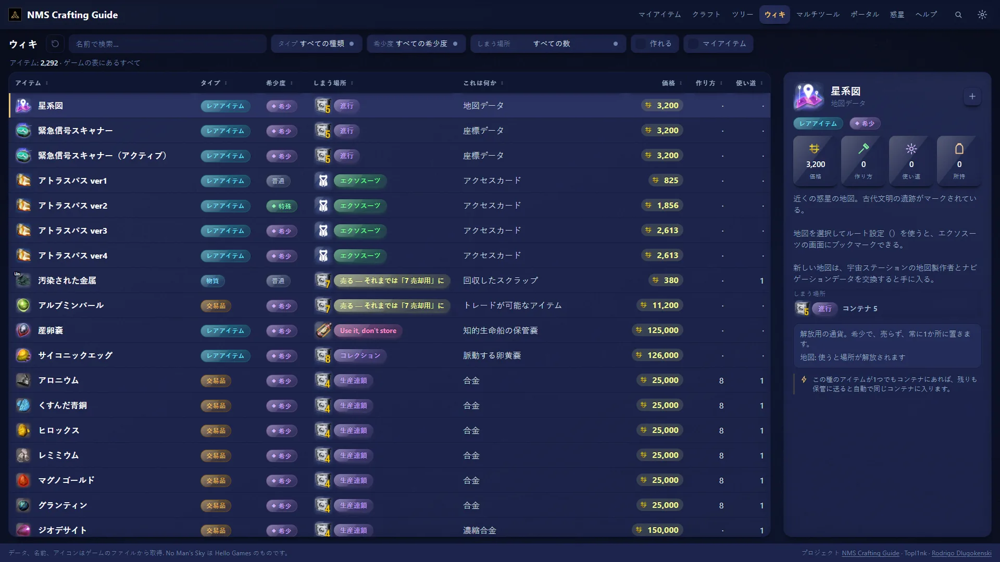 <b>Wiki。</b> ゲーム内の全アイテムとそのカード。</td>
  </tr>
  <tr>
    <td width="50%">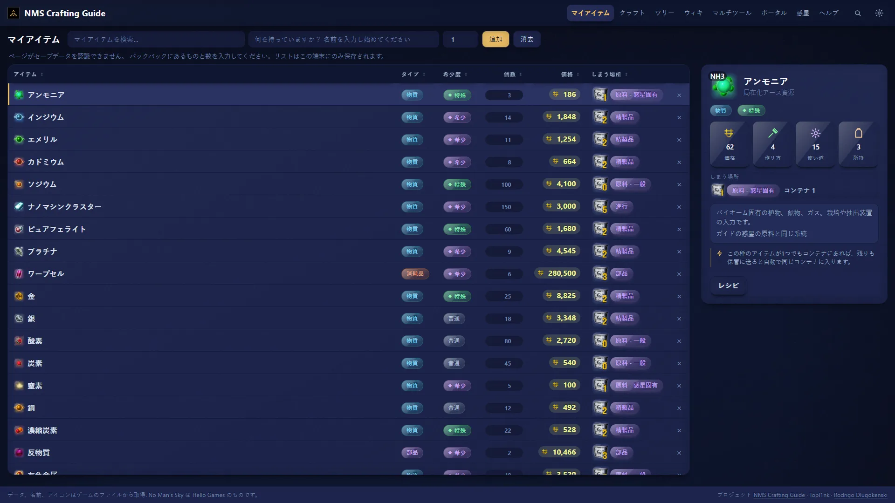 <b>マイアイテム。</b> 所持品と、それぞれの収納先。</td>
    <td width="50%">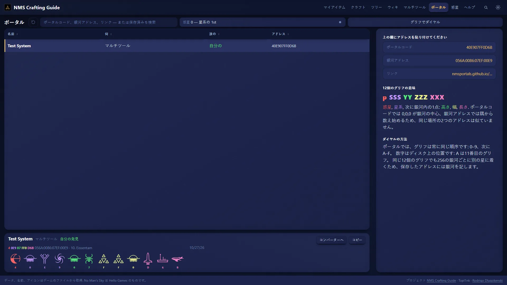 <b>ポータル。</b> コードとアドレス、グリフ付き。</td>
  </tr>
  <tr>
    <td width="50%">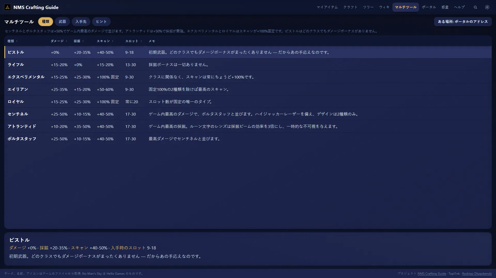 <b>マルチツール。</b> 8種類を比較し、最良のものを入手する方法。</td>
    <td width="50%">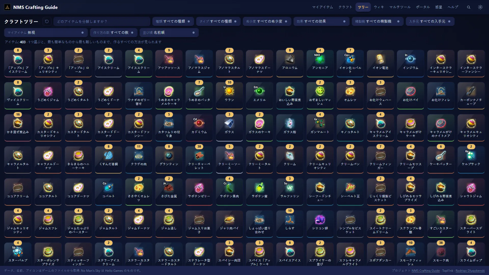 <b>作れるアイテムを選ぶと、</b> その作り方が分かります。</td>
  </tr>
  <tr>
    <td width="50%">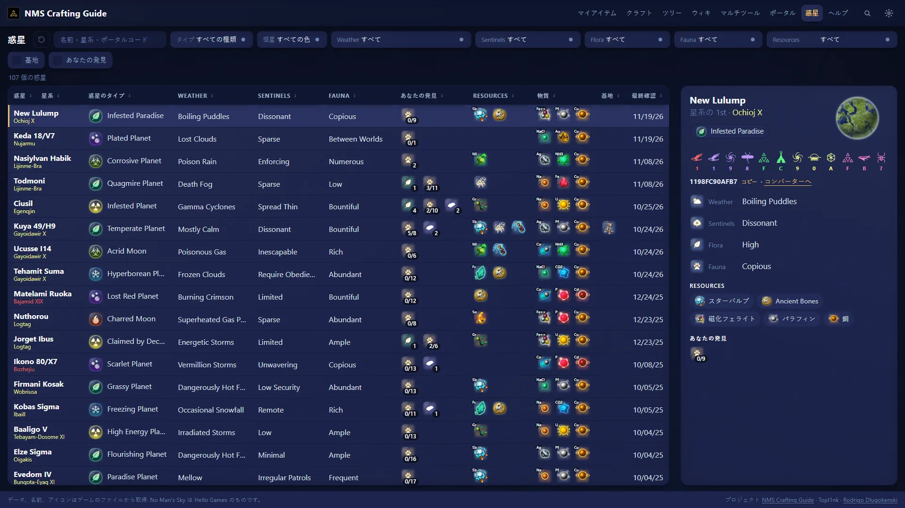 <b>惑星。</b> 天候、センチネル、植物、動物、資源つきの、あなたの惑星一覧。</td>
    <td width="50%">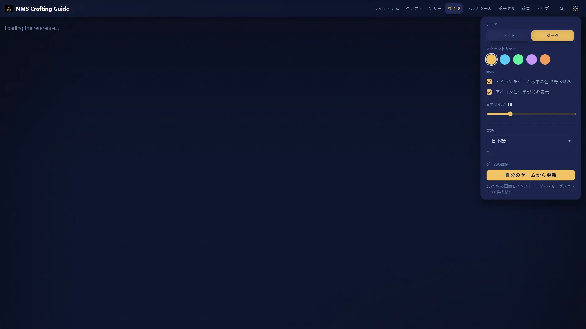 <b>設定。</b> テーマ、言語、セーブデータ、アップデートを一つのメニューに。</td>
  </tr>
</table>

### あなたの惑星

「惑星」ページには、セーブデータにあるすべての惑星が並びます。名前と星系（恒星の色で表示）、タイプ、天候、センチネル、植物と動物、そこで見つけた数、惑星の資源と物質、あなたの拠点です。セーブにないものは、ゲームと同じ方法で惑星のシード値から計算するので、ゲーム内で見るものと一致します。惑星を選ぶと、地球儀、ポータルのグリフ、全リストを載せたカードが開きます。一覧は、タイプ、恒星、天候、センチネル、植物、動物、資源、拠点、発見の有無で絞り込めます。Wikiでは、惑星で手に入るアイテムに「惑星で探す」ボタンがあり、適切な絞り込みでこのページを開きます。

## 知っておくと便利

- **ライト/ダーク、** 好きなアクセントカラー、大きな文字、光るアイコン。すべて設定メニューから。
- **最短ルート。** アイテムを選ぶと、どの惑星でも拾える素材から、精製機の占有が最も少ない手順で作る方法を探します。
- **ゲームのアップデート後は、** アプリがゲームから数値を読み直せるので、古くなりません。
- **セーブデータ。** セーブとそのスロットは設定メニューで一度選ぶだけ。それを読むすべてのページが同じ選択を使います。
- **アップデート。** 歯車に点が付くと、新しいバージョンが出ています。自動インストールは初期状態でオフ。設定メニューでオンにするか、ボタン一つで更新できます。
- **どの言語でも検索。** どの言語の名前でも入力できます。「Tainted Metal」も「Испорченный металл」も同じアイテムが見つかります。ほかの言語は、プログラムがあなたのゲームからバックグラウンドで自動的に用意します。
- **印刷用の早見表。** 覚えておく価値のあるレシピを `docs/pdf/` に収録。

## クレジット

- デスクトップアプリとインターフェース: **[Topl1nk](https://github.com/Topl1nk)**
- 中核・レシピ・データ: **[Rodrigo Dlugokenski](https://github.com/rdlu)**, [nms-items-interface](https://github.com/rdlu/nms-items-interface)

NMS Crafting Guide は Rodrigo Dlugokenski 氏の [nms-items-interface](https://github.com/rdlu/nms-items-interface) のフォークとして始まり、その後作り直されました。新しいページ、デスクトップアプリ、全17言語、現行ゲームから読み取ったデータが加わっています。ポータルのグリフは [nmsportals](https://nmsportals.github.io/) を元に描き起こしました。

*No Man's Sky* とそのすべての名前・画像・テキストは Hello Games のものです。これは非公式のファンプロジェクトです。ライセンスは [GPL-3.0](../../LICENSE)。ビルドや改変は [docs/DEVELOPERS.md](../DEVELOPERS.md)(英語)を参照してください。

  

