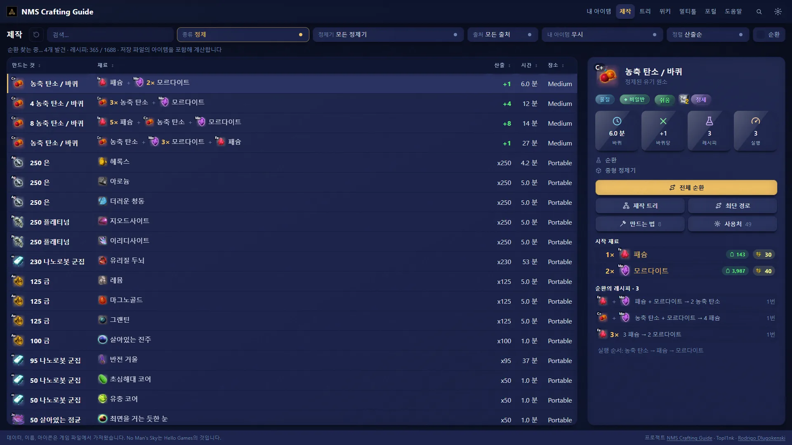
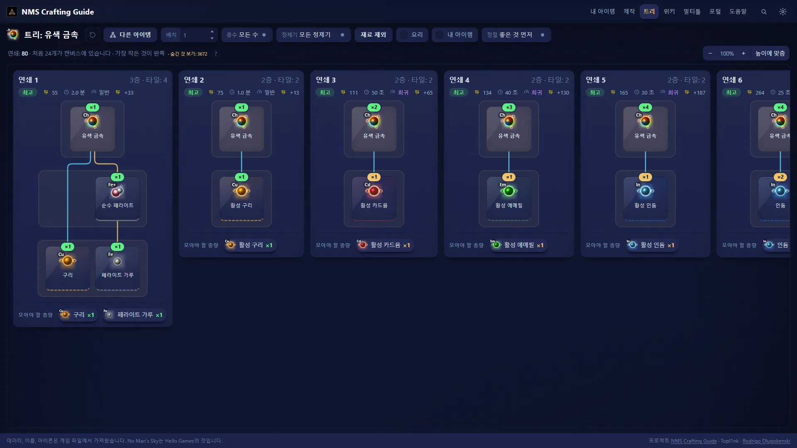
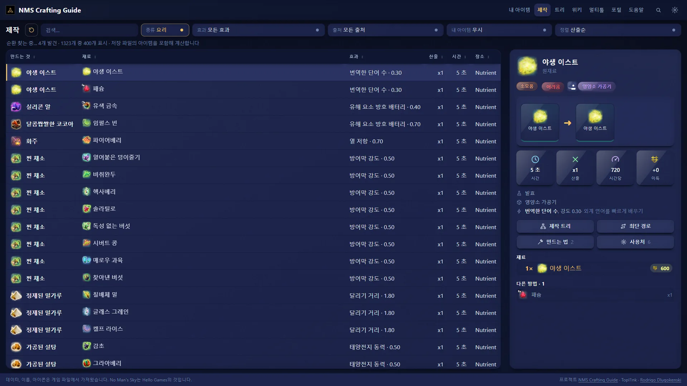
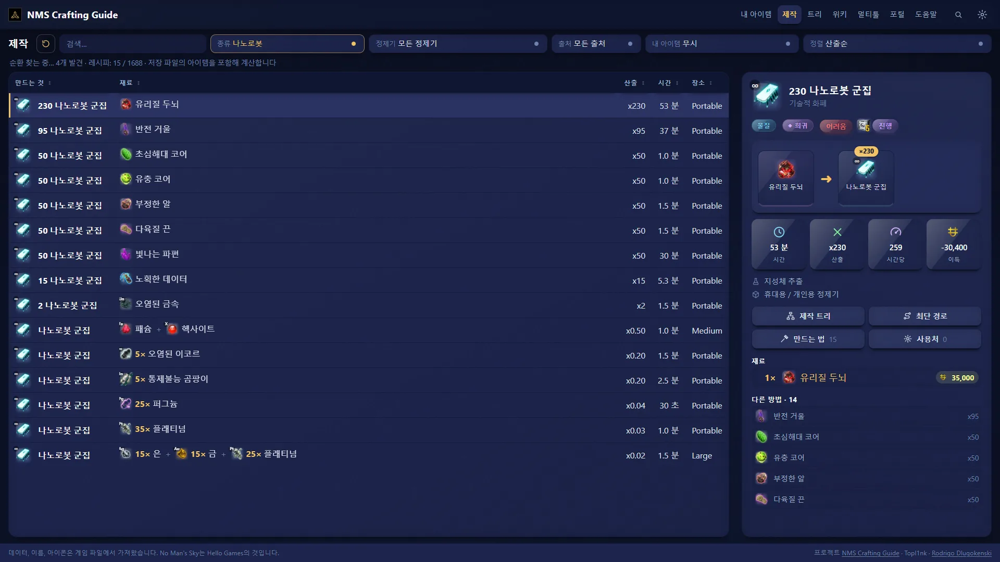
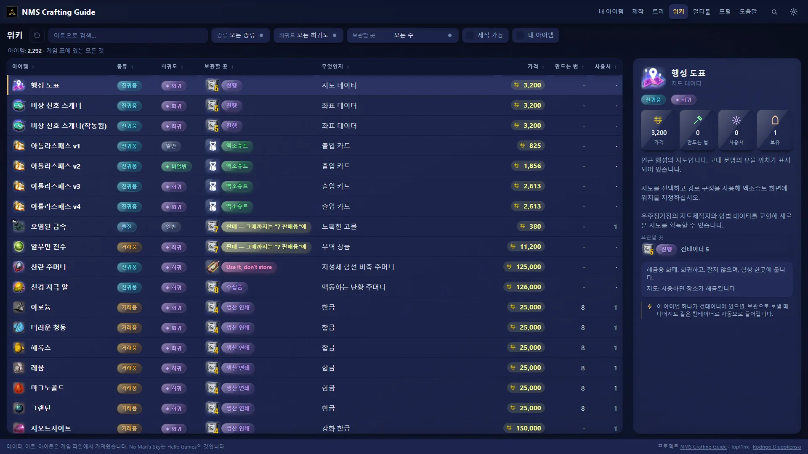
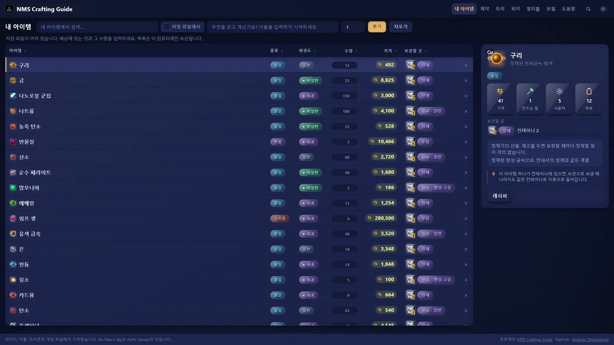
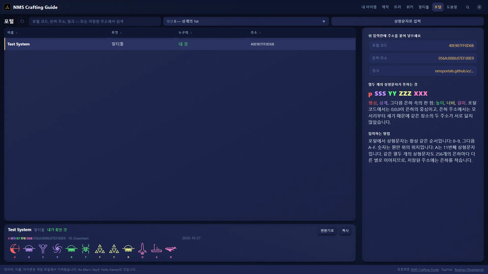
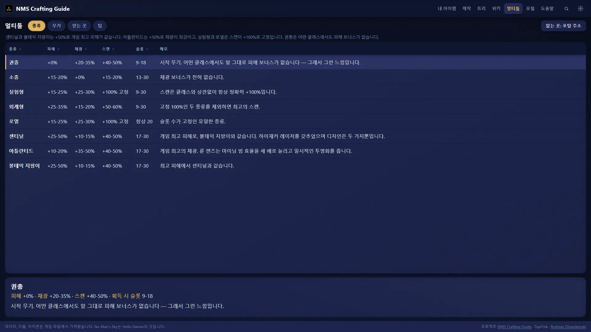
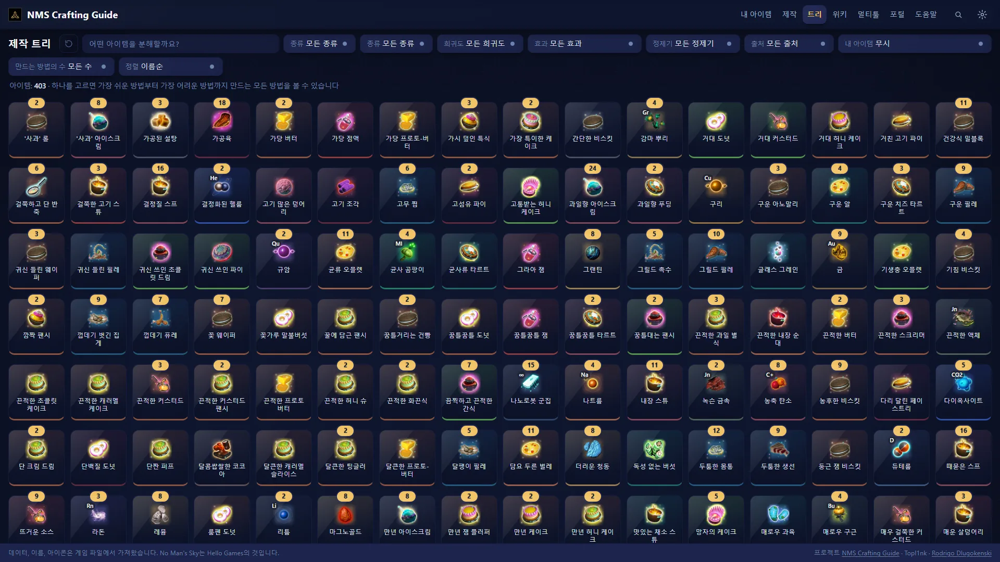

  
  
  

  
  
  
  

[English](../../README.md) · [Русский](README.ru.md) · [Português (Brasil)](README.pt-BR.md) · [Português](README.pt.md) · [Español](README.es.md) · [Français](README.fr.md) · [Deutsch](README.de.md) · [Italiano](README.it.md) · [Nederlands](README.nl.md) · [Polski](README.pl.md) · [日本語](README.ja.md) · **한국어** · [简体中文](README.zh-CN.md) · [繁體中文](README.zh-TW.md)

## 무엇인가요?

정제기 앞에 서서 이런 생각을 한 적 있으시죠. *이건 뭐가 되지? 지금 가진 걸로 그 아이템을 가장 빨리 얻으려면?* NMS Crafting Guide가 클릭 몇 번으로 답해 드립니다.

내 컴퓨터에서 돌아가는 작은 프로그램입니다. 레시피, 가격, 이름을 **내 게임에서 직접** 읽어 오기 때문에, 오래된 패치를 기억하던 위키가 아니라 게임이 실제로 쓰는 수치가 나옵니다.

- 🧪 **모든 레시피를 한 표에.** 정제, 요리, 나나이트 경로. 수율, 시간, 이익으로 정렬할 수 있습니다.
- 🌳 **아이템을 만드는 모든 방법을 트리로.** 가장 쉬운 방법부터 가장 어려운 방법까지.
- 🍲 **먹을까, 팔까?** 원하는 효과의 요리를 찾고 판매가도 확인하세요.
- 📦 **어디에 넣을까?** 각 아이템이 들어갈 보관함을 알려 줍니다.
- 🔁 **돈 순환.** 서로 재료를 이어 주어 넣은 것보다 더 남는 레시피.
- 🔭 **포털 주소.** 어떤 형식의 코드든 입력하면 입력할 글리프를 보여 줍니다.
- ⚔ **멀티툴** 을 나란히 비교하고, 좋은 것을 얻는 법도 알려 줍니다.
- ️ **17개 언어.** 게임과 같은 언어입니다. 아이템 이름도 언어에 따라 바뀝니다.
- 🌍 **프라이버시.** 아무것도 내 컴퓨터 밖으로 나가지 않습니다. 계정이 필요 없고, 첫 실행 후에는 인터넷도 필요 없습니다.

## 설치

| | |
| --- | --- |
| **Windows** | [최신 릴리스](https://github.com/Topl1nk/nms-crafting-guide/releases/latest)에서 `nms-crafting-guide-Setup-….exe`를 내려받아 실행하세요. 관리자 권한은 필요 없습니다. 설치 프로그램은 14개 언어를 지원합니다. |
| **Linux** | `nms-crafting-guide-….AppImage`를 내려받아 실행 권한을 주고 더블클릭하세요. |

> [!NOTE]
> 새 프로그램이고 서명이 없어서 Windows가 *"Windows의 PC 보호"* 화면을 보여 줄 수 있습니다. *추가 정보 → 실행*을 누르세요.

> [!IMPORTANT]
> **처음 실행.** NMS Crafting Guide는 설치된 No Man's Sky(Steam 또는 GOG)를 찾아 아이템 그림을 가져옵니다. 몇 분 걸리며 한 번만 일어납니다. 그림과 텍스트는 내 컴퓨터에만 남으며, Hello Games의 것이므로 업로드되지 않습니다.

> [!TIP]
> 아직 준비되지 않은 언어로 바꾸면 첫 전환에 약 1분이 걸리고, 그 뒤 이름이 바로 바뀝니다.

## 화면 둘러보기

<table>
  <tr>
    <td width="50%"> <b>제작 트리.</b> 아이템을 만드는 모든 방법과 모아야 할 재료.</td>
    <td width="50%"> <b>요리.</b> 원하는 효과에 가장 강한 요리.</td>
  </tr>
  <tr>
    <td width="50%"> <b>나나이트.</b> 시간당 나나이트로 정렬한 모든 경로.</td>
    <td width="50%"> <b>위키.</b> 게임의 모든 아이템과 카드.</td>
  </tr>
  <tr>
    <td width="50%"> <b>내 아이템.</b> 가진 것과 각각 들어갈 곳.</td>
    <td width="50%"> <b>포털.</b> 코드와 주소, 글리프 그림 포함.</td>
  </tr>
  <tr>
    <td width="50%"> <b>멀티툴.</b> 여덟 종류 비교와 최고의 것을 얻는 법.</td>
    <td width="50%"> <b>만들 수 있는 아이템을 고르면</b> 만드는 법이 보입니다.</td>
  </tr>
</table>

## 알아 두면 좋은 점

- **라이트/다크,** 원하는 강조 색, 큰 글자, 빛나는 아이콘. 모두 설정 메뉴에서.
- **최단 경로.** 아이템을 고르면 어느 행성에서든 주울 수 있는 재료로, 정제기를 가장 적게 쓰는 방법을 찾아 줍니다.
- **게임 업데이트 후에는** 앱이 내 게임에서 수치를 다시 읽을 수 있어 오래되지 않습니다.
- **인쇄용 요약표.** 외워 둘 만한 레시피를 `docs/pdf/`에 담았습니다.

## 크레딧

- 데스크톱 앱과 인터페이스: **[Topl1nk](https://github.com/Topl1nk)**
- 핵심, 레시피, 데이터: **[Rodrigo Dlugokenski](https://github.com/rdlu)**, [nms-items-interface](https://github.com/rdlu/nms-items-interface)

NMS Crafting Guide는 Rodrigo Dlugokenski의 [nms-items-interface](https://github.com/rdlu/nms-items-interface) 포크로 시작해 이후 다시 만들어졌습니다. 새 페이지, 데스크톱 앱, 17개 언어 전체, 현재 게임에서 읽은 데이터가 추가되었습니다. 포털 글리프는 [nmsportals](https://nmsportals.github.io/)를 따라 그렸습니다.

*No Man's Sky*와 그 모든 이름, 그림, 텍스트는 Hello Games의 것입니다. 이 프로젝트는 비공식 팬 프로젝트입니다. 라이선스는 [GPL-3.0](../../LICENSE). 직접 빌드하거나 수정하려면 [docs/DEVELOPERS.md](../DEVELOPERS.md)(영어)를 보세요.

  

