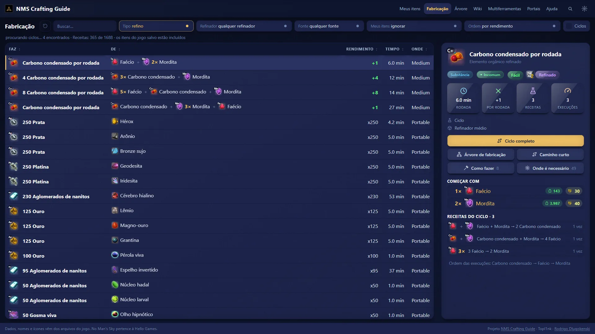
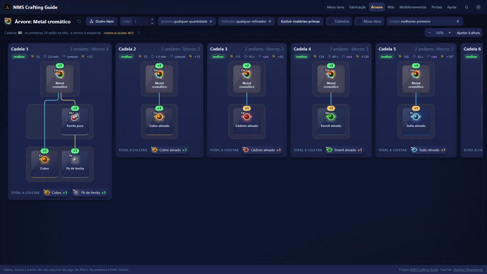
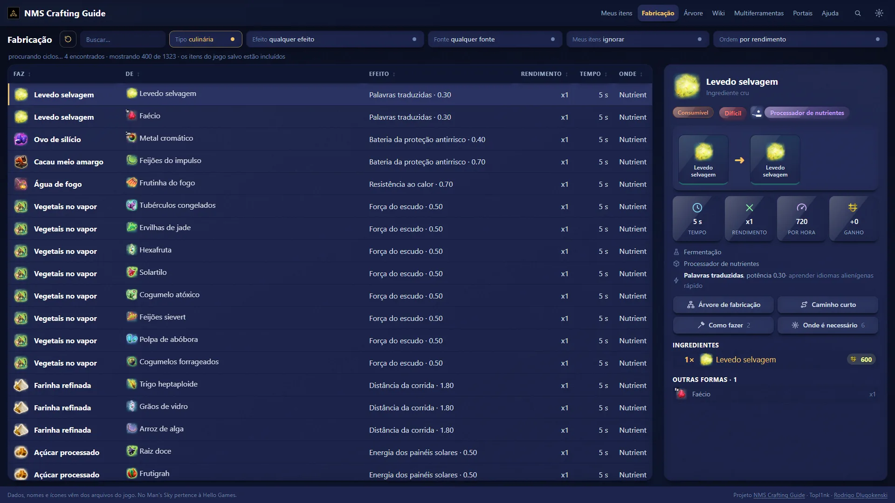
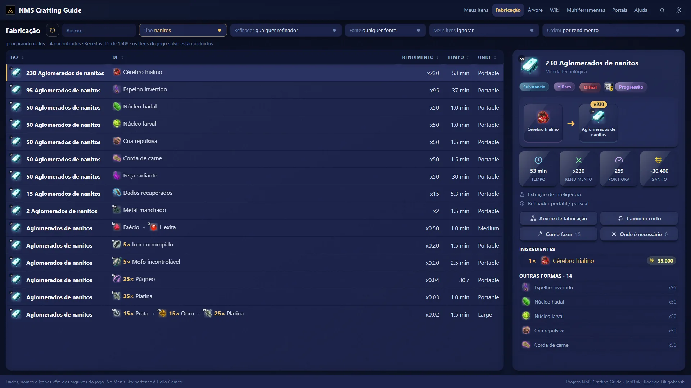
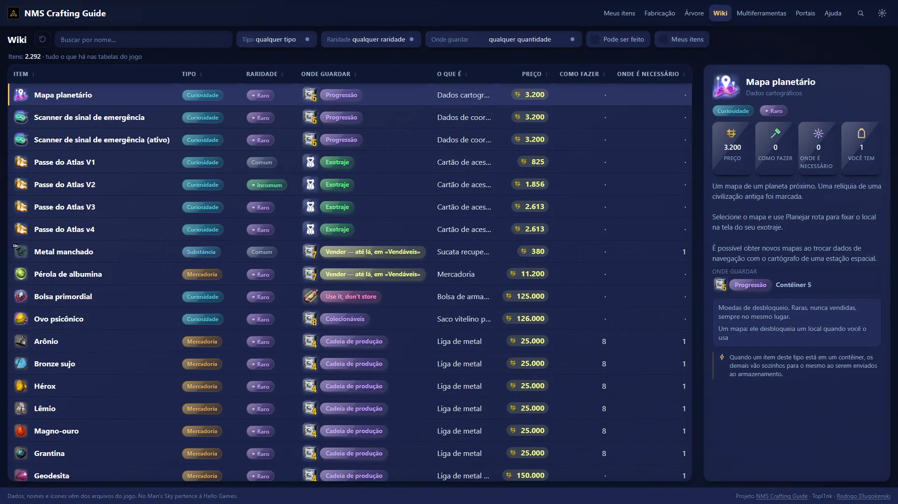
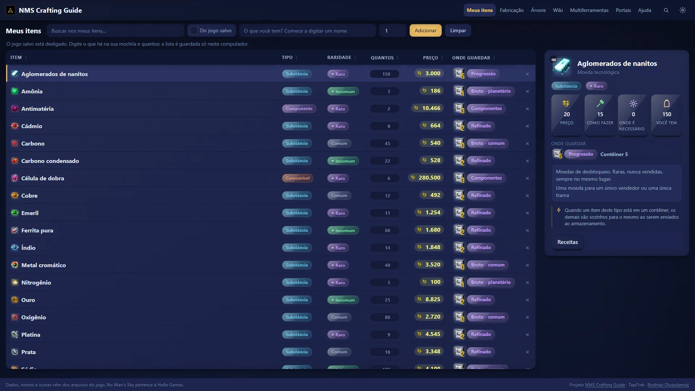
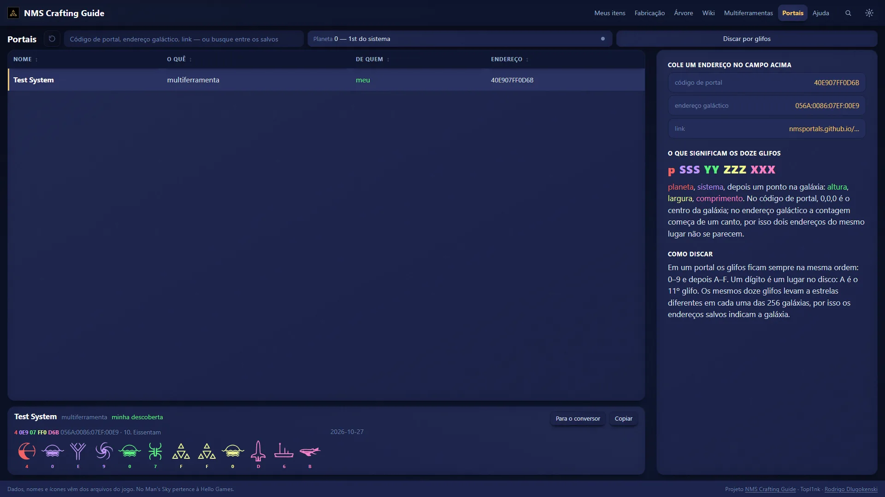
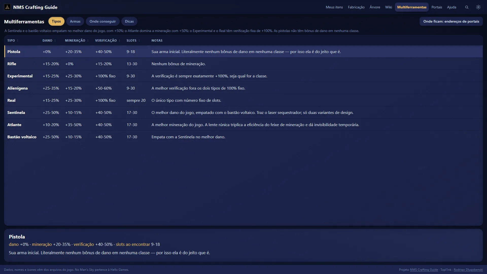
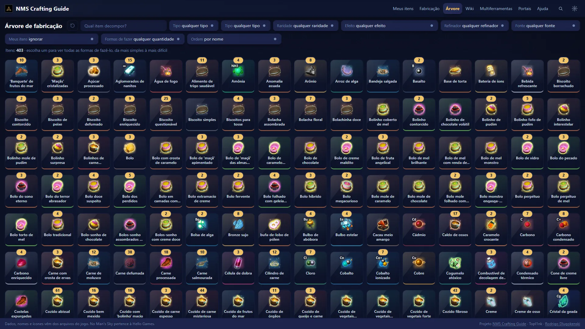

  
  
  

  
  
  
  

[English](../../README.md) · [Русский](README.ru.md) · **Português (Brasil)** · [Português](README.pt.md) · [Español](README.es.md) · [Français](README.fr.md) · [Deutsch](README.de.md) · [Italiano](README.it.md) · [Nederlands](README.nl.md) · [Polski](README.pl.md) · [日本語](README.ja.md) · [한국어](README.ko.md) · [简体中文](README.zh-CN.md) · [繁體中文](README.zh-TW.md)

## O que é?

Você está diante de um refinador e se pergunta: *no que isto se transforma e qual o jeito mais rápido de conseguir esse item com o que eu tenho?* O NMS Crafting Guide responde em poucos cliques.

É um programa pequeno para o seu computador. Ele lê receitas, preços e nomes **direto da sua própria cópia do jogo**, então os números são os que o jogo realmente usa, e não o que uma wiki lembrava de um patch antigo.

- 🧪 **Todas as receitas numa tabela.** Refino, culinária e rotas de nanites. Ordene por rendimento, tempo ou lucro.
- 🌳 **Todas as formas de fazer um item,** desenhadas como uma árvore, da mais simples à mais difícil.
- 🍲 **Comer ou vender?** Ache o prato com o efeito que você quer e veja por quanto ele vende.
- 📦 **Onde guardar?** Cada item com o armazenamento a que pertence.
- 🔁 **Ciclos de dinheiro.** Receitas que se alimentam e deixam você com mais do que começou.
- 🔭 **Endereços de portal.** Digite um código em qualquer formato e veja os glifos para discar.
- ⚔ **Multiferramentas** comparadas lado a lado, e como conseguir as boas.
- ️ **17 idiomas,** os mesmos do jogo. Os nomes dos itens também mudam com o idioma.
- 🌍 **Privado.** Nada sai do seu computador. Sem conta e sem internet depois da primeira execução.

## Instalação

| | |
| --- | --- |
| **Windows** | Baixe `nms-crafting-guide-Setup-….exe` da [última versão](https://github.com/Topl1nk/nms-crafting-guide/releases/latest) e execute. Não precisa de administrador. O instalador fala 14 idiomas. |
| **Linux** | Baixe `nms-crafting-guide-….AppImage`, torne-o executável e dê um duplo clique. |

O Windows pode mostrar *"O Windows protegeu o seu PC"*, porque o programa é novo e não é assinado. Clique em *Mais informações → Executar assim mesmo*.

**Primeira execução.** O NMS Crafting Guide encontra o seu No Man's Sky (Steam ou GOG) e tira as imagens dos itens dele. Leva alguns minutos e acontece uma vez. Ao trocar para um idioma ainda não preparado, a primeira troca leva cerca de um minuto, e os nomes mudam na hora. Imagens e textos ficam no seu computador; pertencem à Hello Games e nunca são enviados.

## Uma olhada

<table>
  <tr>
    <td width="50%"> <b>Árvore de criação.</b> Todas as formas de fazer um item e o que juntar.</td>
    <td width="50%"> <b>Culinária.</b> Os melhores pratos para o efeito que você quer.</td>
  </tr>
  <tr>
    <td width="50%"> <b>Nanites.</b> Todas as rotas, por nanites por hora.</td>
    <td width="50%"> <b>Wiki.</b> Todos os itens do jogo com sua ficha.</td>
  </tr>
  <tr>
    <td width="50%"> <b>Meus itens.</b> O que você leva e onde cada coisa vai.</td>
    <td width="50%"> <b>Portais.</b> Códigos e endereços, com os glifos desenhados.</td>
  </tr>
  <tr>
    <td width="50%"> <b>Multiferramentas.</b> Oito tipos comparados e como obter as melhores.</td>
    <td width="50%"> <b>Escolha qualquer item</b> que possa ser feito e veja como.</td>
  </tr>
</table>

## Bom saber

- **Claro ou escuro,** qualquer cor de destaque, texto maior, ícones brilhantes. Tudo no menu de configurações.
- **Caminho curto.** Escolha um item e o NMS Crafting Guide acha como fazê-lo com coisas que se pega em qualquer planeta, no plano que ocupa menos o refinador.
- **Depois de uma atualização do jogo** o app lê de novo os números do seu jogo, então nada fica velho.
- **Folha de consulta para imprimir** com as receitas que valem decorar, em `docs/pdf/`.

## Créditos

- App de desktop e interface: **[Topl1nk](https://github.com/Topl1nk)**
- Núcleo, receitas e dados: **[Rodrigo Dlugokenski](https://github.com/rdlu)**, [nms-items-interface](https://github.com/rdlu/nms-items-interface)

O NMS Crafting Guide começou como um fork do [nms-items-interface](https://github.com/rdlu/nms-items-interface), de Rodrigo Dlugokenski, e foi reconstruído desde então: novas páginas, app de desktop, os 17 idiomas e dados lidos do jogo atual. Os glifos de portal foram traçados de [nmsportals](https://nmsportals.github.io/).

*No Man's Sky*, com todos os seus nomes, imagens e textos, pertence à Hello Games; este é um projeto de fã não oficial. Licença [GPL-3.0](../../LICENSE). Quer compilar ou alterar? Veja [docs/DEVELOPERS.md](../DEVELOPERS.md) (em inglês).

  

