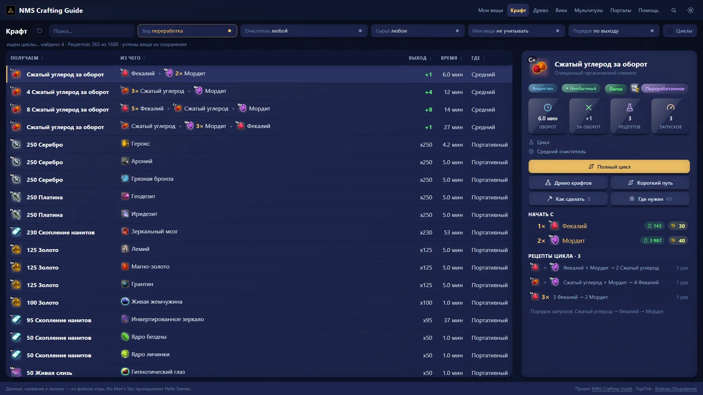
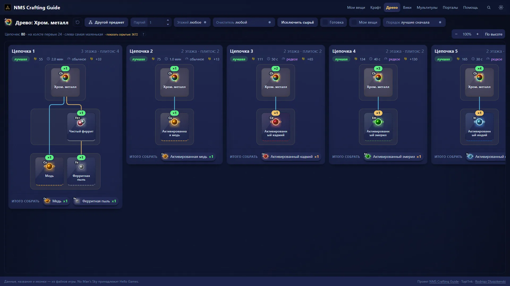
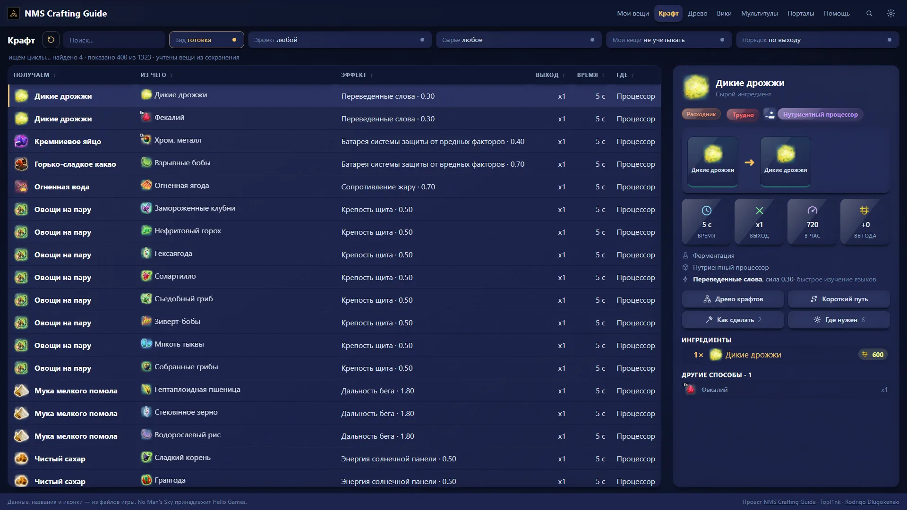
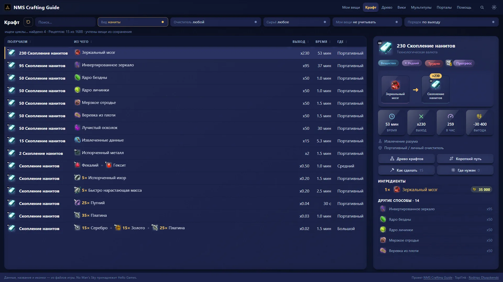
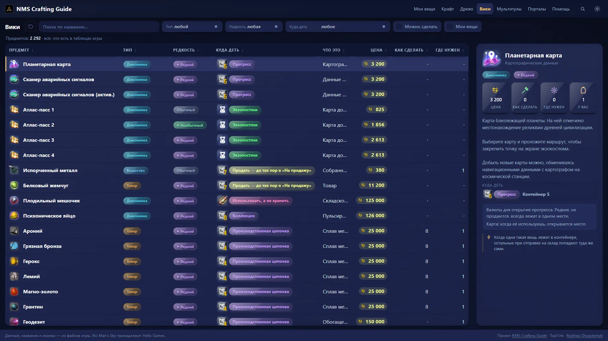
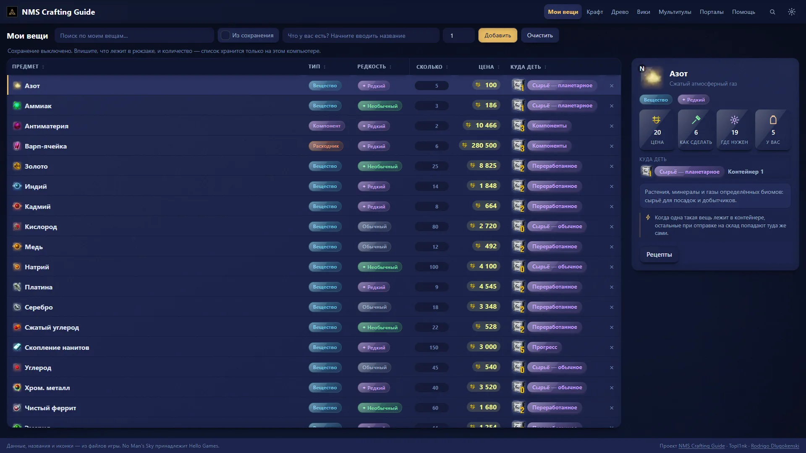
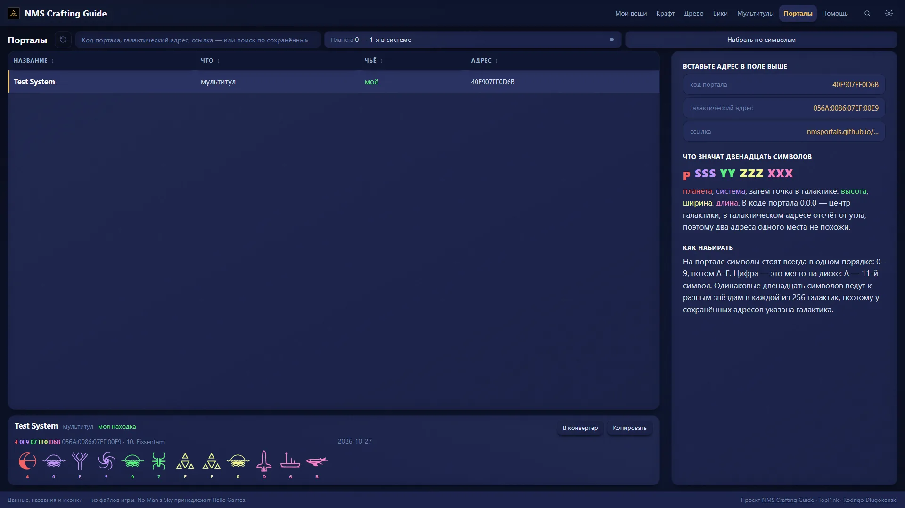
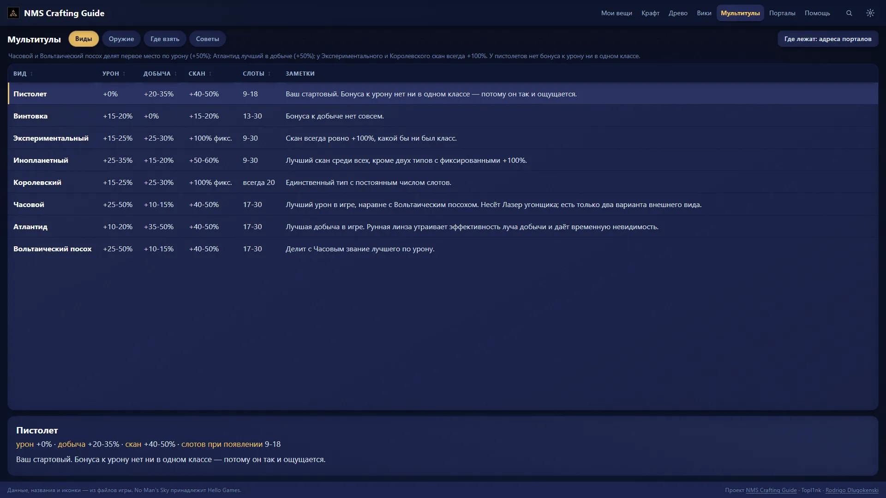
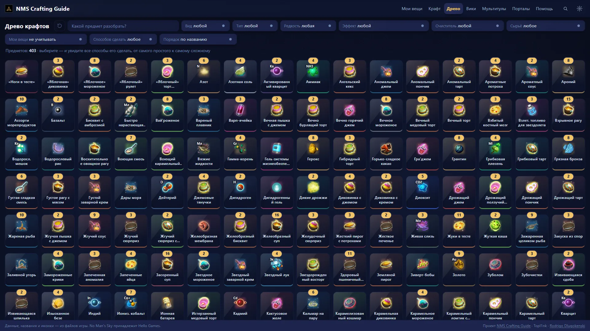

  
  
  

  
  
  
  

[English](../../README.md) · **Русский** · [Português (Brasil)](README.pt-BR.md) · [Português](README.pt.md) · [Español](README.es.md) · [Français](README.fr.md) · [Deutsch](README.de.md) · [Italiano](README.it.md) · [Nederlands](README.nl.md) · [Polski](README.pl.md) · [日本語](README.ja.md) · [한국어](README.ko.md) · [简体中文](README.zh-CN.md) · [繁體中文](README.zh-TW.md)

## Что это?

Вы стоите у очистителя и думаете: *во что это превратится и как быстрее всего получить нужный предмет из того, что у меня
есть?* NMS Crafting Guide отвечает за пару кликов.

Это небольшая программа для компьютера. Рецепты, цены и названия она берёт **прямо из вашей копии игры**, поэтому цифры
такие, какие игра использует на самом деле, а не те, что вики запомнила со старого патча.

- 🧪 **Все рецепты в одной таблице.** Переработка, готовка и пути к нанитам. Сортировка по выходу, времени и прибыли.
- 🌳 **Все способы сделать предмет** в виде дерева, от самого простого до самого сложного.
- 🍲 **Съесть или продать?** Найдите блюдо с нужным эффектом и узнайте, за сколько оно продаётся.
- 📦 **Куда это положить?** У каждого предмета указано подходящее хранилище.
- 🔁 **Денежные циклы.** Рецепты, которые подпитывают друг друга и оставляют больше, чем вы вложили.
- 🔭 **Адреса порталов.** Введите код в любом виде и увидите глифы для набора.
- ⚔️ **Мультитулы** рядом друг с другом и способы получить хорошие.
- 🌍 **17 языков**, те же, что в игре. Вместе с языком меняются и названия предметов.
- 🔒 **Приватно.** Ничего не уходит с вашего компьютера. Аккаунт не нужен, после первого запуска интернет тоже.

## Установка

| | |
| --- | --- |
| **Windows** | Скачайте `nms-crafting-guide-Setup-….exe` из [последнего релиза](https://github.com/Topl1nk/nms-crafting-guide/releases/latest) и запустите. Права администратора не нужны. Установщик говорит на 14 языках. |
| **Linux** | Скачайте `nms-crafting-guide-….AppImage`, сделайте его исполняемым и откройте двойным щелчком. |

> [!NOTE]
> Windows может показать предупреждение *«Windows защитила ваш компьютер»*: программа новая и не подписана. Нажмите
> *Подробнее → Выполнить в любом случае*.

> [!IMPORTANT]
> **Первый запуск.** NMS Crafting Guide находит установленную No Man's Sky (Steam или GOG) и берёт из неё картинки предметов. Это занимает несколько минут и происходит один раз. Картинки и тексты остаются на вашем компьютере: они принадлежат Hello Games и никуда не загружаются.

> [!TIP]
> Если выбрать язык, который ещё не подготовлен, первое переключение займёт около минуты, после чего названия предметов сменятся сразу.

## Посмотрите сами

<table>
  <tr>
    <td width="50%"> <b>Дерево крафта.</b> Все способы сделать предмет и что для этого собрать.</td>
    <td width="50%"> <b>Готовка.</b> Сильнейшие блюда для нужного эффекта.</td>
  </tr>
  <tr>
    <td width="50%"> <b>Наниты.</b> Все пути, отсортированные по нанитам в час.</td>
    <td width="50%"> <b>Вики.</b> Все предметы игры с карточками.</td>
  </tr>
  <tr>
    <td width="50%"> <b>Мои вещи.</b> Что у вас есть и куда что класть.</td>
    <td width="50%"> <b>Порталы.</b> Коды и адреса с нарисованными глифами.</td>
  </tr>
  <tr>
    <td width="50%"> <b>Мультитулы.</b> Восемь типов рядом и как получить лучшие.</td>
    <td width="50%"> <b>Любой предмет,</b> который можно сделать, и как.</td>
  </tr>
</table>

## Полезно знать

- **Светлая или тёмная тема**, любой акцентный цвет, крупный текст, светящиеся иконки. Всё в меню настроек.
- **Короткий путь.** Выберите предмет, и NMS Crafting Guide найдёт, как сделать его из того, что можно подобрать на любой планете,
  выбрав план, который меньше всего занимает очиститель.
- **После обновления игры** программа может заново прочитать новые цифры из вашей игры, так что они не устаревают.
- **Шпаргалка для печати** с рецептами, которые стоит запомнить, лежит в `docs/pdf/`.

## Авторы

- Приложение для компьютера и интерфейс: **[Topl1nk](https://github.com/Topl1nk)**
- Основа, рецепты и данные: **[Rodrigo Dlugokenski](https://github.com/rdlu)**, [nms-items-interface](https://github.com/rdlu/nms-items-interface)

NMS Crafting Guide начался как форк [nms-items-interface](https://github.com/rdlu/nms-items-interface) Rodrigo Dlugokenski и с тех
пор переделан: новые страницы, приложение для компьютера, все 17 языков и данные из актуальной версии игры.
Глифы порталов перерисованы с [nmsportals](https://nmsportals.github.io/). *No Man's Sky*, а также все её названия,
картинки и тексты принадлежат Hello Games; это неофициальный фанатский проект.

Лицензия [GPL-3.0](../../LICENSE). Хотите собрать или изменить? См. [../DEVELOPERS.md](../DEVELOPERS.md) (на английском).

  

