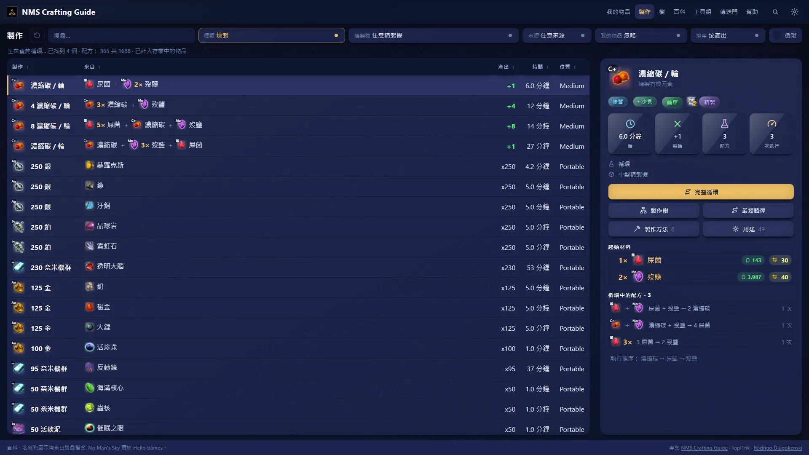
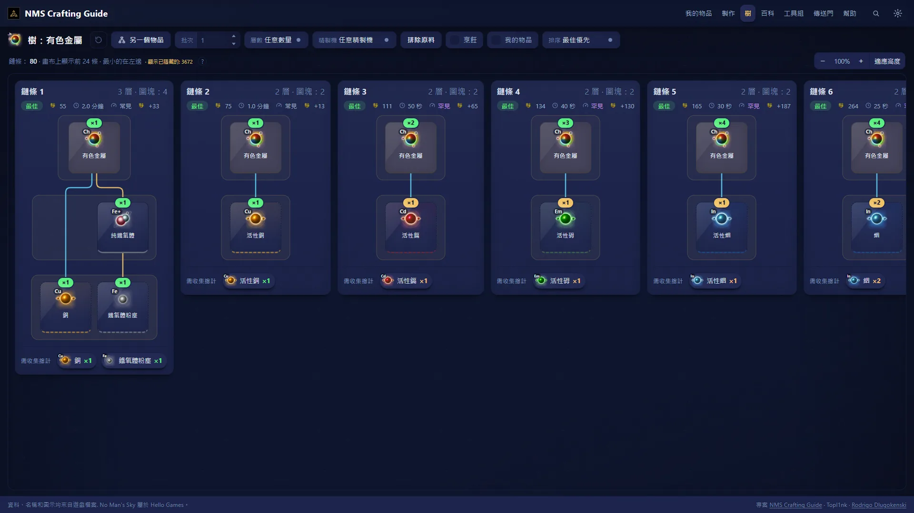
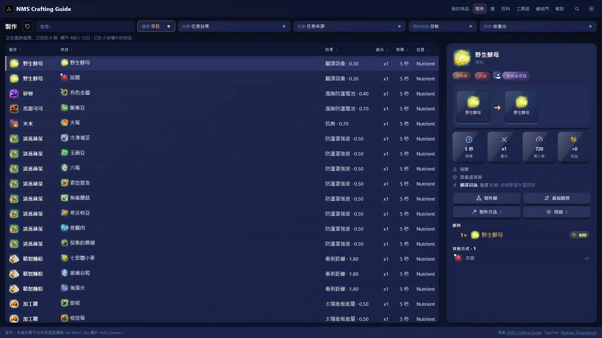
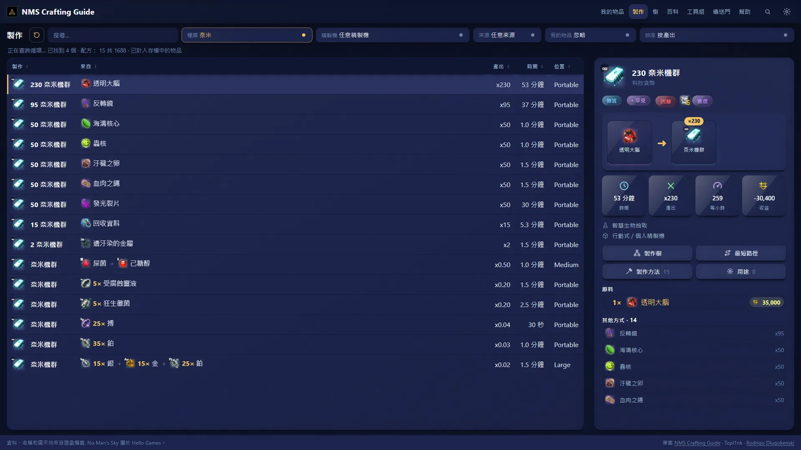
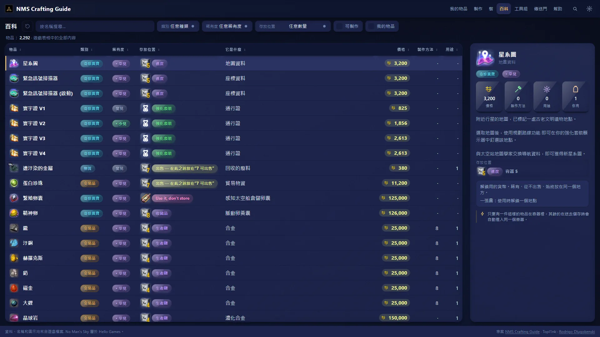
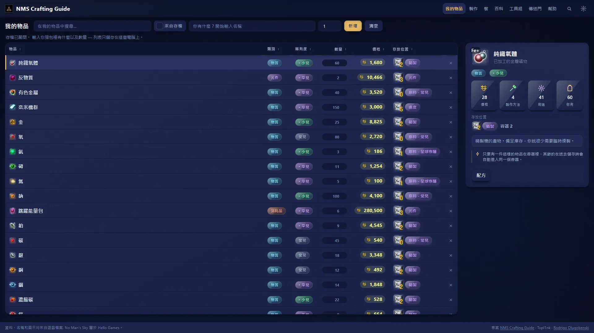
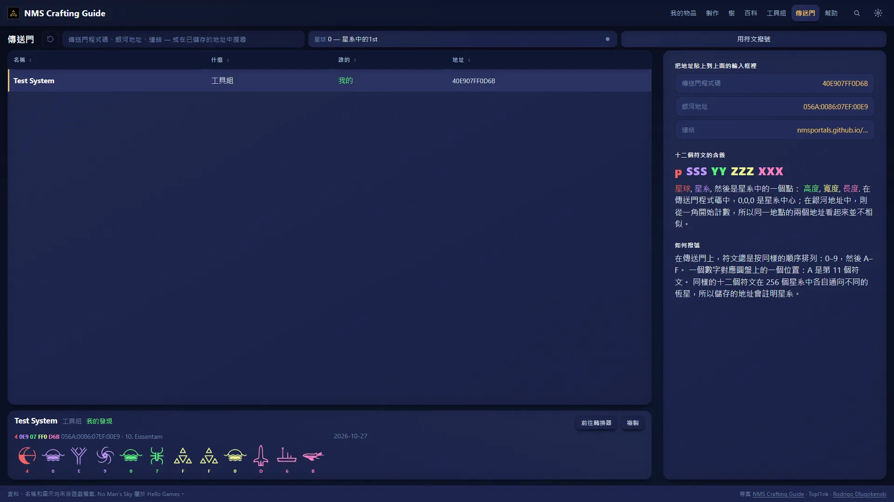
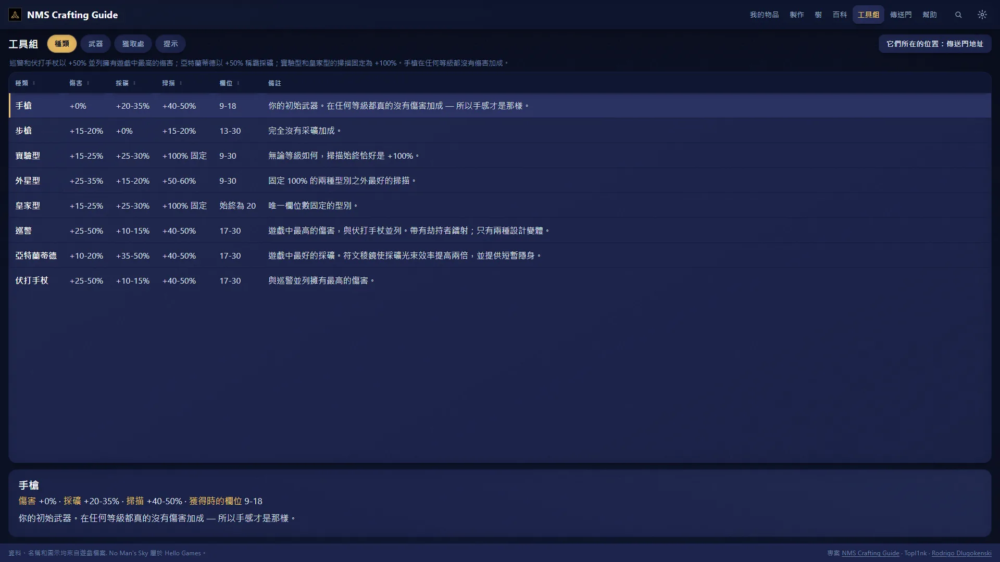
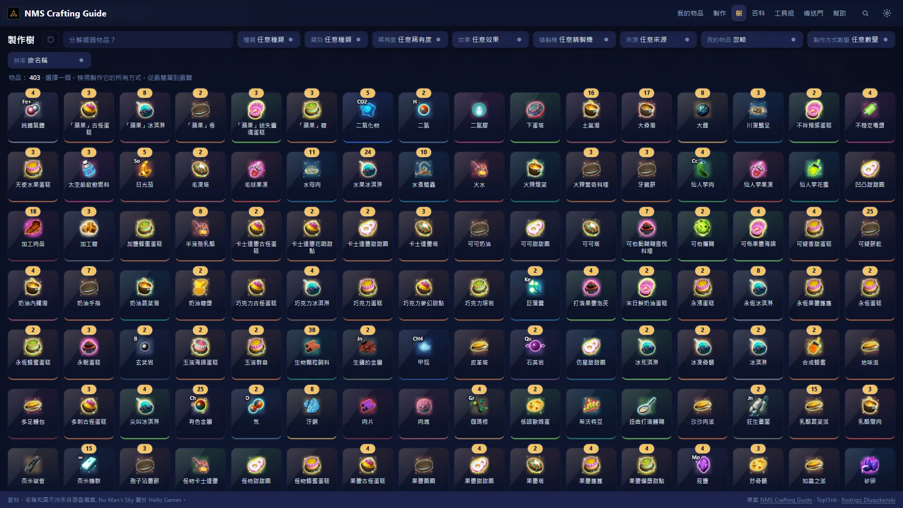

  
  
  

  
  
  
  

[English](../../README.md) · [Русский](README.ru.md) · [Português (Brasil)](README.pt-BR.md) · [Português](README.pt.md) · [Español](README.es.md) · [Français](README.fr.md) · [Deutsch](README.de.md) · [Italiano](README.it.md) · [Nederlands](README.nl.md) · [Polski](README.pl.md) · [日本語](README.ja.md) · [한국어](README.ko.md) · [简体中文](README.zh-CN.md) · **繁體中文**

## 這是什麼?

你站在精煉器前,心想:*這個會變成什麼?用我身上的東西,最快怎麼得到那個物品?* NMS Crafting Guide 點幾下就能回答。

這是一個裝在你電腦上的小程式。它**直接從你自己的遊戲**讀取配方、價格和名稱,所以數字就是遊戲真正在用的,而不是某個維基記著的舊更新資料。

- 🧪 **所有配方一張表。** 精煉、烹飪和奈米簇路線。可依產出、時間或利潤排序。
- 🌳 **製作物品的每種方法,** 畫成一棵樹,從最簡單到最難。
- 🍲 **吃還是賣?** 找到有你想要效果的料理,並看它的售價。
- 📦 **放哪裡?** 每個物品都標明該放進哪種儲存空間。
- 🔁 **賺錢循環。** 彼此供料、最後比投入更多的配方。
- 🔭 **傳送門地址。** 以任何形式輸入代碼,就能看到要撥的字形。
- ⚔ **多功能工具** 並排比較,並告訴你怎麼拿到好的。
- ️ **17 種語言,** 與遊戲相同。物品名稱也會隨語言切換。
- 🌍 **隱私。** 任何資料都不會離開你的電腦。不需帳號,首次執行後也不需連網。

## 安裝

| | |
| --- | --- |
| **Windows** | 從[最新版本](https://github.com/Topl1nk/nms-crafting-guide/releases/latest)下載 `nms-crafting-guide-Setup-….exe` 並執行。不需要系統管理員權限。安裝程式支援 14 種語言。 |
| **Linux** | 下載 `nms-crafting-guide-….AppImage`,賦予可執行權限後按兩下執行。 |

因為程式較新且未簽署,Windows 可能顯示*「Windows 已保護您的電腦」*。請按*其他資訊 → 仍要執行*。

**第一次啟動。** NMS Crafting Guide 會找到你安裝的《無人深空》(Steam 或 GOG),並從中取出物品圖片。這需要幾分鐘,只會發生一次。切換到尚未準備好的語言時,第一次切換約需一分鐘,之後名稱會立刻改變。圖片和文字都留在你的電腦上,它們屬於 Hello Games,絕不會被上傳。

## 看一看

<table>
  <tr>
    <td width="50%"> <b>製作樹。</b> 製作物品的每種方法以及要收集什麼。</td>
    <td width="50%"> <b>烹飪。</b> 針對你想要效果的最強料理。</td>
  </tr>
  <tr>
    <td width="50%"> <b>奈米簇。</b> 所有路線,依每小時奈米簇排序。</td>
    <td width="50%"> <b>百科。</b> 遊戲裡所有物品及其卡片。</td>
  </tr>
  <tr>
    <td width="50%"> <b>我的物品。</b> 你帶著什麼,以及每樣東西該放哪裡。</td>
    <td width="50%"> <b>傳送門。</b> 代碼與地址,附帶繪製好的字形。</td>
  </tr>
  <tr>
    <td width="50%"> <b>多功能工具。</b> 八種類型比較,以及如何拿到最好的。</td>
    <td width="50%"> <b>選擇任何可製作的物品,</b> 看看怎麼做。</td>
  </tr>
</table>

## 小提示

- **淺色或深色,** 任意強調色、更大的文字、發光圖示。全在設定選單裡。
- **最短路徑。** 選一個物品,NMS Crafting Guide 會找出用任何星球上都撿得到的東西製作它、且最少佔用精煉器的方案。
- **遊戲更新後,** 應用程式可以重新從你的遊戲讀取數字,所以不會過時。
- **可列印的速查表,** 收錄值得記住的配方,在 `docs/pdf/`。

## 致謝

- 桌面應用與介面: **[Topl1nk](https://github.com/Topl1nk)**
- 核心、配方與資料: **[Rodrigo Dlugokenski](https://github.com/rdlu)**, [nms-items-interface](https://github.com/rdlu/nms-items-interface)

NMS Crafting Guide 最初是 Rodrigo Dlugokenski 的 [nms-items-interface](https://github.com/rdlu/nms-items-interface) 的分支,此後被重新打造:新頁面、桌面應用程式、全部 17 種語言,以及從目前遊戲讀取的資料。傳送門字形描摹自 [nmsportals](https://nmsportals.github.io/)。

《無人深空》及其所有名稱、圖片和文字屬於 Hello Games;這是一個非官方的粉絲專案。授權為 [GPL-3.0](../../LICENSE)。想自己建置或修改?見 [docs/DEVELOPERS.md](../DEVELOPERS.md)(英文)。

  

